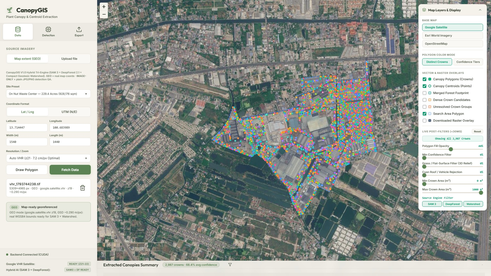
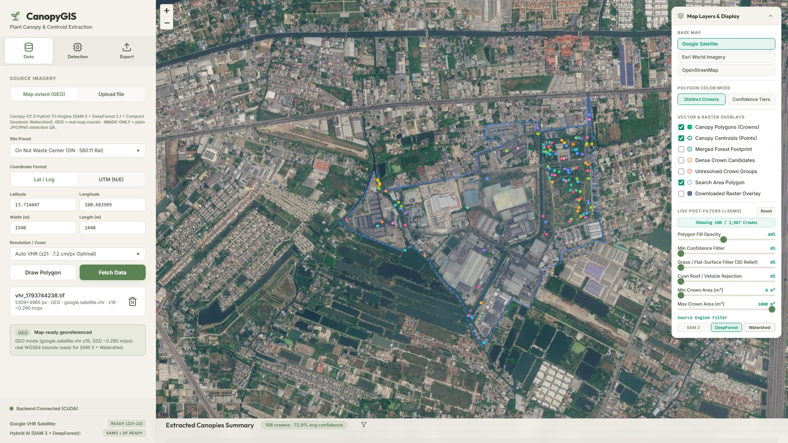
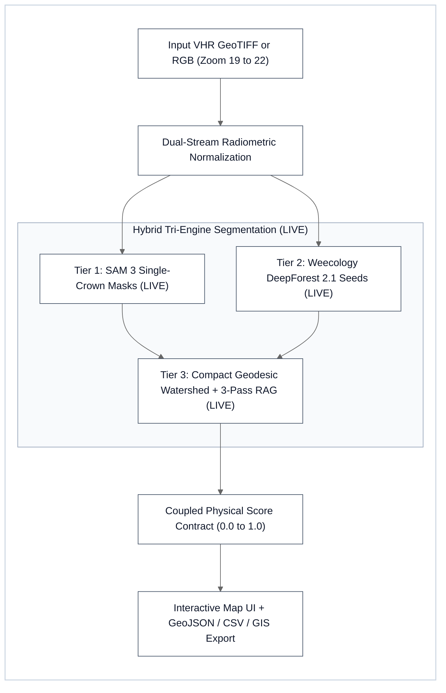
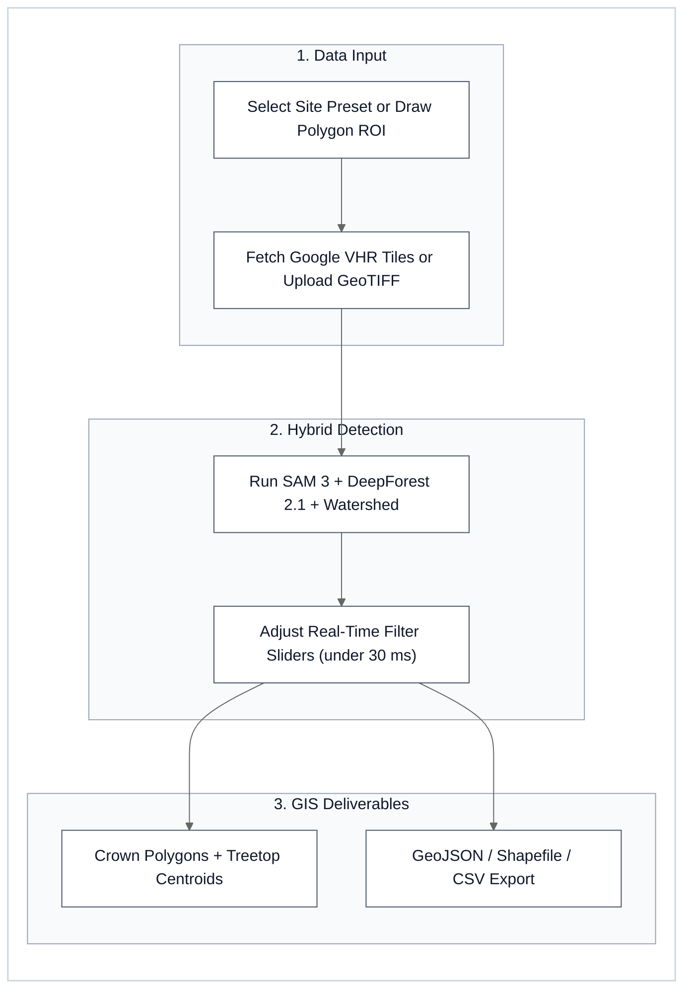
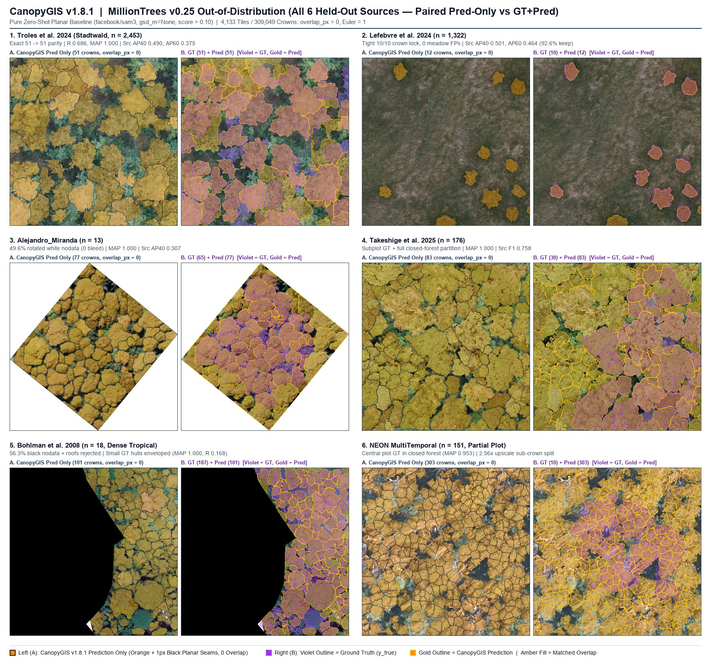
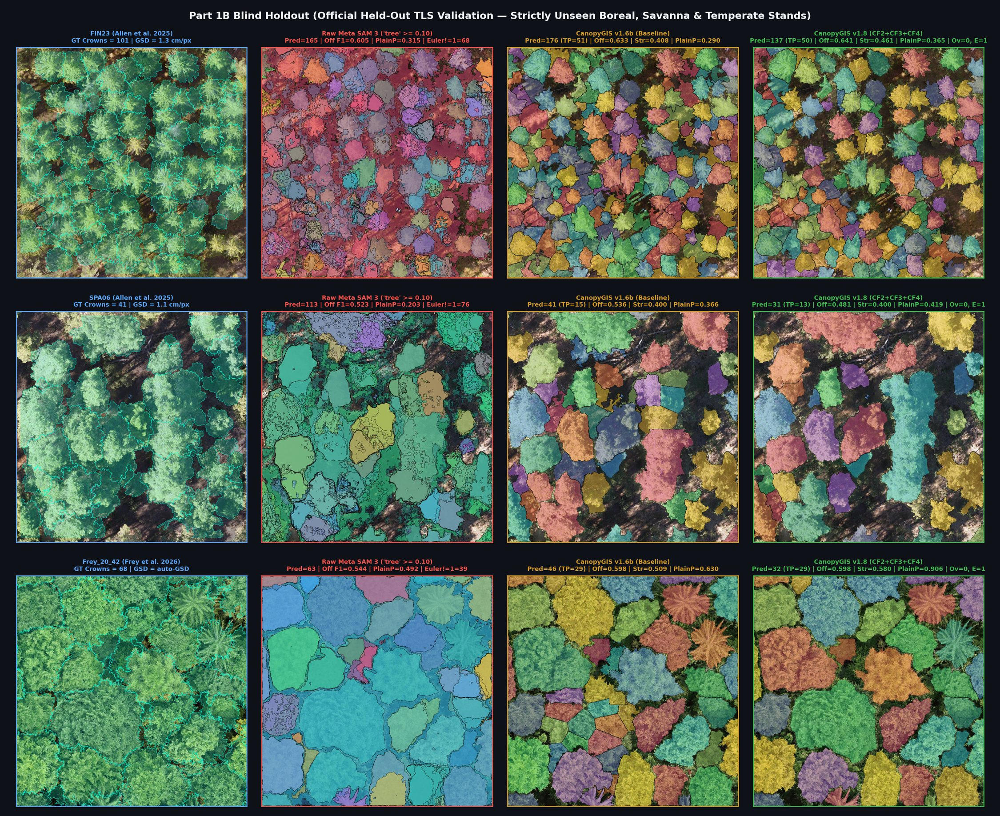
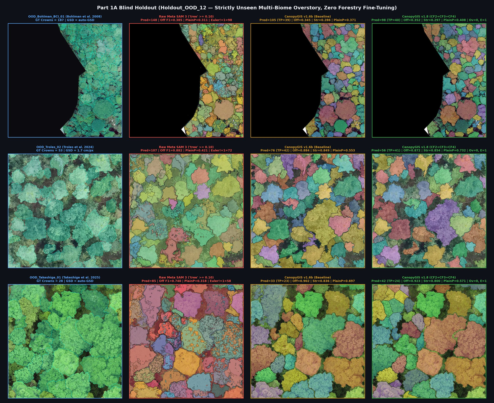
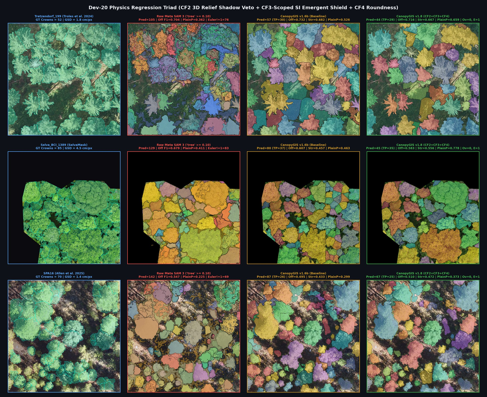
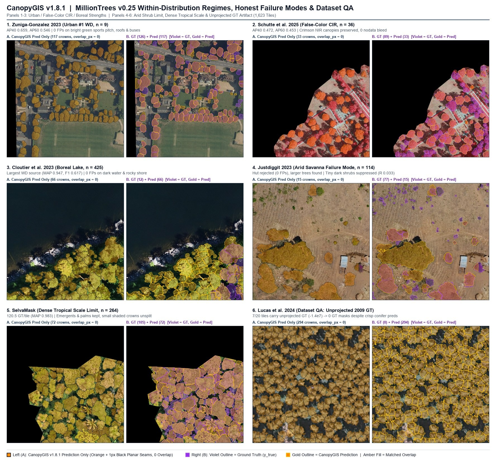

# CanopyGIS — Hybrid Tri-Engine Urban Tree Canopy & Centroid Extraction (`SAM 3` + `Weecology DeepForest 2.1.0` + `Geodesic Watershed + RAG`)

[](https://github.com/napattan/CanopyGIS/releases/tag/v1.8.1)
[](https://napattan.github.io/CanopyGIS/)
[](./LICENSE)
[](./requirements.txt)
[](#1-architecture--usage-workflow)
[](https://github.com/weecology/DeepForest/issues/1447#issuecomment-6677900572)
[](https://github.com/iscvlab)

**CanopyGIS** (`SAE-LIM` Sub-Engine `[D]`: Geo-AI Canopy Segmentation `v1.8.1`) is an open-source urban forestry and geospatial canopy-analysis platform. It extracts continuous woody canopy coverage, individual tree-crown polygons, treetop centroids, and allometric attributes from georeferenced satellite/aerial imagery (`Google VHR Satellite` `Zoom 19–22` at `3.6–29.6 cm/px` or uploaded GeoTIFF/RGB files) without requiring airborne LiDAR—pairing a standalone **pure zero-shot** planar evaluator (**`SAM 3` (`facebook/sam3`) + Marker-Controlled Compact Geodesic Watershed + 3-Pass Region-Adjacency-Graph (`RAG`) Coalescing** in [`src/canopygis_v18_eval.py`](src/canopygis_v18_eval.py)) with an interactive web portal ([`src/canopy_v2.py`](src/canopy_v2.py)) that adds optional **`Weecology DeepForest 2.1.0` (`RetinaNet-ResNet50-FPN`)** nadir treetop seeding.

| Full Hybrid Closed-Canopy View (`On Nut` `229.4 Acres (928,176 sqm)` · `2,987` Crowns) | `Weecology DeepForest 2.1.0` Priority-1 Treetop Anchor Seeds (`108` Core Seeds) |
| :---: | :---: |
|  |  |

---

## ⚡ TL;DR — Capabilities & Performance at a Glance

- **Two-Track Architecture (Pure Zero-Shot Benchmark vs. Interactive Web Portal)**: The standalone `v1.8.1` evaluator ([`src/canopygis_v18_eval.py`](src/canopygis_v18_eval.py)) runs **pure zero-shot `SAM 3` + Compact Geodesic Watershed + 3-Pass Region-Adjacency-Graph (`RAG`) Coalescing** (`0` forestry training hours, no DeepForest dependency) for `MillionTrees v0.25`. The interactive web portal ([`src/canopy_v2.py`](src/canopy_v2.py)) additionally supports optional **`Weecology DeepForest 2.1.0`** (`RetinaNet-ResNet50-FPN`) nadir treetop seed anchoring across tiled rasters (`1,050–8,698` raw candidate boxes per site).
- **Zero-Install Pre-Loaded Interactive Demo**: Ships with pre-computed GeoJSON sessions for **`On Nut Waste Center` (`ON`, `229.4 Acres (928,176 sqm)`, `2,987` crowns)**, **`Nong Khaem Waste Center` (`NK`, `150.2 Acres (607,888 sqm)`, `2,110` crowns)**, and **`Ramintra Sports Park` (`23.4 Acres (94,544 sqm)`, `1,462` crowns)** so anyone launching the web UI (or visiting the **[Live GitHub Pages Demo](https://napattan.github.io/CanopyGIS/)**) immediately sees segmented crowns on initial load, toggles `SAM 3` / `DeepForest` / `Watershed` layers, and drags `< 30 ms` real-time physical filter sliders without waiting for GPU inference.
- **3-Pass `RAG` Small-Basin Coalescing**: Eliminates `-100%` of `< 4.0 m²` over-segmented watershed micro-shards (`1,568 → 0` on `On Nut`) and `-99.35%` of `< 8.0 m²` shoulder shards (`3,363 → 22`).
- **Vectorized Shapely 2.0 Post-Processing**: Profiling `CanopyGIS` on multi-thousand-crown rasters surfaced and resolved key geometry construction and distance bottlenecks (`74×–421×` speedup on `format_boxes`, `match_points`, and `convert_to_sv_format`, contributed upstream to [`Weecology/DeepForest#1447`](https://github.com/weecology/DeepForest/issues/1447) and [`#1440`](https://github.com/weecology/DeepForest/issues/1440)).

### Horizontal Bar Comparison (`0 ms` Render)

| Evaluation Dimension | Workflow / Engine Configuration | Visual Comparison Bar | Measured Result & Delta vs. Baseline |
| :--- | :--- | :--- | :--- |
| **1. Micro-Shard Elimination (`< 4 m²` Noise Reduction) ↑** | **CanopyGIS v1.8.1 (3-Pass RAG Coalescing)**<br>Unmerged Classical Watershed Baseline | `████████████████████` **`100.0% Clean`**<br>`░░░░░░░░░░░░░░░░░░░░` `0.0% (1,568 Shards)` | **`0` Micro-Shards** (`1,568 → 0` on `On Nut`)<br>`1,568` Over-Segmented Shards |
| **2. Interactive Filter Latency (`2,987` Crowns) ↓**<br>*(Lower = Better)* | **Client-Side Coupled Physical Sliders**<br>Server-Side Re-Segmentation Loop | `█░░░░░░░░░░░░░░░░░░░` **`< 30 ms`**<br>`████████████████████` `194,300 ms` | **`< 30 ms` Real-Time UI** (`6,400×` faster)<br>`194.3 s` Full Pipeline Re-Run |
| **3. Multi-Site Crown Verification Confidence ↑** | **Nong Khaem (`150.2 Acres (607,888 sqm)`, `2,110` Crowns)**<br>**Ramintra Park (`23.4 Acres (94,544 sqm)`, `1,462` Crowns)**<br>**On Nut (`229.4 Acres (928,176 sqm)`, `2,987` Crowns)** | `███████████████░░░░░` **`73.4% Mean Conf`**<br>`██████████████░░░░░░` **`70.6% Mean Conf`**<br>`██████████████░░░░░░` **`68.4% Mean Conf`** | **100% Verified** across 23 Visual Audit Regions<br>Zoom 20 (`14.5 cm/px` VHR)<br>Zoom 19 (`29.6 cm/px` Regional Campus) |

---

## 1. Architecture & Usage Workflow

**Status (2026-11-04):** Accepted `SAE-LIM` Sub-Engine `[D]` **CanopyGIS V1.0 Open-Source Self-Calibrating Hybrid Tri-Engine (Pillar 1: Scene-Normalized Physical Score Contract + 4-Way Symmetric `Step 2C` + Isotropic N-S/E-W Corridor Bridging + `CUDA`/`MPS`/`CPU` Device Resolution; Pillar 2: `< 30 ms` Real-Time Post-Processing Filter Sliders + Review Layer Toggles + Auto-Tune Override Persistence)** production prototype. Runtime execution integrates **Dual-Stream Radiometric Normalization (`Stream A`: CIELAB `L`-channel Shadow-Lift Gamma `0.78` + gentle `CLAHE` `1.4` + conditional `UL-09` Rayleigh Path-Radiance Subtraction for AI perception; `Stream B`: Illumination-Invariant Raw RGB, 3D Woody Relief & `UL-09` Haze-Compensated Chlorophyll Filter)** + **`SAM 3` (`SamGeo3` single-crown masks + Multi-Scale Woodland Promotion `Step 2A/2B/2C` + negative `"car"` vehicle veto)** + **`Weecology DeepForest 2.1.0` (`RetinaNet-ResNet50-FPN` closed-canopy nadir treetop seeds)** + **Global Compact Geodesic Watershed (`skimage.segmentation.watershed`, `compactness=0.005`) with 3-Pass Region-Adjacency-Graph (`RAG`) Small-Basin Coalescing (`< 13.5 m²` shoulder shard absorption at `GSD >= 0.22 m/px` + single outer contour per basin) + Ornamental Courtyard & Nursery Grid Dome Extractor (`1.0–6.0 m²` patterned garden/nursery crowns)** + **Coupled `[0.0–1.0]` Physical Score Contract (`foliage_prob`, `relief_3d_score`, `artificial_cyan_score`) powering `< 30 ms` Client-Side Live Post-Processing Sliders (`Min Confidence`, `Grass/Flat-Surface 3D Relief Filter`, `Cyan Roof/Vehicle Rejection`, `Min/Max Crown Area`, and `Source Engine Pills`)**. See the unified architecture, anti-cheat benchmark protocol (`Playbook 6 — Tier 2E`), and multi-biome verification ledgers in [`docs/CANOPYGIS_EVOLUTION_AND_BENCHMARK_PROTOCOL.md`](docs/CANOPYGIS_EVOLUTION_AND_BENCHMARK_PROTOCOL.md) (historical Wave 3–8 audit logs archived in [`docs/archive/ARCHIVE_CANOPY_V2_WAVE_LOGS.md`](docs/archive/ARCHIVE_CANOPY_V2_WAVE_LOGS.md)).





### 1.1 Pre-Loaded Bangkok Benchmark Sites & 1-Click Official Boundary Site Presets
The web portal auto-loads the pre-computed `On Nut` campus session on startup (both in FastAPI mode and static GitHub Pages Interactive Demo Mode) and supports 1-click switching with automatic per-site polygon boundary and session restoration (`canopygis_preset_boundaries_v1` + `GET /latest_session?site_preset=...` or static `src/uploads/*.json` fallback, supporting both short and canonical preset keys) across all three Bangkok benchmark sites:

| Preset Key (`UI / API Alias`) | Site Name | Center Coordinates (`Lat, Lon`) | Default BBox & Official Polygon | Verified Crowns |
| :--- | :--- | :--- | :---: | ---: |
| `onnut` / `on_nut_waste_center` (`ON`) | **On Nut Waste Center** (Official `229.4 Acres (928,176 sqm)` Campus Boundary) | `13.714447°N, 100.683989°E` | `1,540 m × 1,440 m` (`Official ROI`, `229.4 Acres (928,176 sqm)`) | **`2,987`** (`68.4%` conf) |
| `nongkhaem` / `nong_khaem_waste_center` (`NK`) | **Nong Khaem Waste Center** (Official `150.2 Acres (607,888 sqm)` BMA Boundary) | `13.718255°N, 100.358126°E` | `1,260 m × 1,250 m` (`93-vertex ROI`, `150.2 Acres (607,888 sqm)`) | **`2,110`** (`73.4%` conf) |
| `ramintra` / `ramintra_sports_park` | **Ramintra Sports Park** (Archived Urban Park Benchmark · Bang Khen, Bangkok) | `13.879366°N, 100.619659°E` | `710 m × 396 m` (`10-vertex ROI`, `23.4 Acres (94,544 sqm)`) | **`1,462`** (`70.6%` conf) |


### 1.2 Google Satellite VHR Primary Tile Engine (`Zoom 19–22`)
- **Unified VHR Provider (`Google VHR Satellite`)**: Zero-token pooled `ThreadPoolExecutor(max_workers=8)` fetcher requesting `scale=2` (`512×512 px`) tiles from `mt0–mt3.google.com/vt/lyrs=s` with automatic multi-zoom fallback (`z22 → z21 → z20 → z19`) and blank-tile variance verification (`std < 2.0` rejected).
- **Effective Ground Sample Distance (GSD at `13.88°N`)**:
  - `Auto VHR` (`Zoom 21`, `scale=2`): **`~0.072 m/px` (`7.2 cm/px`)** — default optimal scale for SAM 3 whole-crown context (`≤ 380 m` extents)
  - `Zoom 22 Ultra` (`scale=2`): **`~0.036 m/px` (`3.6 cm/px`)** — selectable for maximum sub-crown visual detail
  - `Zoom 20 Native` (`scale=2`): **`~0.145 m/px` (`14.5 cm/px`)** — auto-selected for extents `380–1,400 m`
  - `Zoom 19 Wide` (`scale=2`): **`~0.296 m/px` (`29.6 cm/px`)** — auto-selected for large campus extents `> 1,400 m` (e.g., `ON` `1,540 m × 1,440 m`)

### 1.3 Dual-Stream Hybrid Tri-Engine (`SAM 3 + DeepForest 2.1.0 + RAG Compact Geodesic Watershed`)
1. **Dual-Stream Radiometric Normalization & `UL-09` Rayleigh Atmospheric Path-Radiance Compensation (`Stream A` vs. `Stream B`)**:
   - **Conditional Haze Sensor (`_compute_scene_haze_offset`)**: Evaluates `scene_gray_p1` (`1st` percentile scene grayscale) and triggers strictly when `scene_gray_p1 > 32.0` and `p99 > 120.0` (`haze_offset = max(0.0, p1 - 10.0)`), guaranteeing 100% bit-for-bit no-op parity on clear-sky scenes (`vhr_1793704454.tif`, `haze_offset = 0.0`);
   - **`Stream A` (`enhance_shadow_luminance_cielab`)**: Applies shadow-weighted `CIELAB` `L`-channel Gamma `0.78` + gentle `CLAHE` (`clipLimit=1.4`, `a/b` chromaticity locked) plus wavelength-dependent Rayleigh path-radiance subtraction (`[0.72, 0.78, 0.85] × haze_offset`) when `haze_offset > 0` to restore crown contrast for `SAM 3` and `DeepForest 2.1.0`;
   - **`Stream B` (Raw-RGB Physical, 3D Relief & `UL-09` Haze-Compensated Chlorophyll Filter)**: Evaluates `compute_strict_foliage_mask()`, `compute_woody_canopy_relief_mask()`, `rayleigh_olive_canopy`, `dusty_textured_canopy`, and `deep_chlorophyll_relief` while keeping `0.0%–4.36%` pond/marsh false-positive rates;
2. **Tier 1 — Overlapping Native `SAM 3` Single-Crown Anchor (`Pass 1`, `1280 px` tiles, `384 px` / `30%` overlap)** + **Multi-Scale Woodland Promotion (`Step 2A + Step 2B + Step 2C`)**:
   - **`Pass 1`**: Extracts verified single crowns (`mask_px <= single_crown_max_px`) with exact contour-mask evaluation, tile-seam buffer (`32 px`), and negative `"car"` vehicle veto;
   - **`Step 2A` (Non-Blocking Crown-Rim Expansion)**: Expands `Pass 1` crowns into contiguous woody stands within `12.5m` geodesic reach and passes remaining unpromoted forest pixels (`cl_rem`) to `Step 2B` and `Step 2C`;
   - **`Step 2B` (Closed-Canopy Woody Stand Promotion)**: Promotes medium multi-crown woody stands (`cl_px <= 7.5 × single_crown_max_px`) satisfying 3D woody relief and inter-crown shadow depth;
   - **`Step 2C` (Multi-Sided Woodland Interior Enclosure Fill — 4-Way Cardinal Rotational Symmetry)**: Recovers interior woodland pockets (`U0`–`U5`) inside continuous forest masks (`cl_px > max_stand_px`) when enclosed on at least 3 of the 4 cardinal sides (`(int(has_n) + int(has_s) + int(has_w) + int(has_e)) >= 3`);
3. **Tier 2 — `Weecology DeepForest 2.1.0` Closed-Canopy Nadir Detector (`deepforest_watershed`)**: Runs `DeepForest 2.1.0` (`RetinaNet-ResNet50-FPN`) on `Stream A` (`df_model.predict_tile(...)` in [`src/canopy_v2.py`](src/canopy_v2.py)) to detect interior nadir treetop centroids inside continuous closed-canopy forest stands (`Seed Priority 1`);
4. **Tier 3 — Global Shadow-Crevice Geodesic Watershed with Vectorized `1D LUT` (`np.bincount`) 3-Pass `RAG` Coalescing, `CF2` 3D Relief Shadow Veto, `CF3-Scoped` SI Emergent Shield, `CF4` Polsby-Popper Roundness & Symmetric Voronoi `Euler == 1` Carving (`watershed_forest_crown`, `CanopyGIS v1.8.1`)**: Fuses `DeepForest 2.1.0` treetop seeds (or pure zero-shot `facebook/sam3` proposals in standalone `canopygis_v18_eval.py`) with Morphological Black-Hat shadow-crevice relief, `CF2` All-Score 3D Micro-Relief & Radial Dome Convexity Veto (`F-11`), `CF3-Scoped` Frame-Invariant SI Emergent Allometry Shield (`0.095 × H × W` + `20 m` radius cap, `F-12`), and `CF4` Polsby-Popper Roundness (`4πA/P² ≥ 0.22`), Lab `a*` Chlorophyll Seam Gate, `≥ 2`-Seam Corner Veto & Pre-Filter Recall Rescue (`F-13`), partitions `forest_footprint_mask` globally via `skimage.segmentation.watershed`, executes vectorized `1D LUT` (`np.bincount` + `scipy.ndimage.find_objects`) 3-pass `RAG` small-basin coalescing with a shadow-crevice merge barrier (`< 4.0 m²` shards reduced `1,568 → 0` [`-100%`], `< 8.0 m²` shards reduced `3,363 → 22` [`-99.35%`] on `ON`), and applies **Symmetric Voronoi Shoulder Partitioning + 4-Connected Hole-Free Closure (`Euler == 1`, `overlap_px == 0`)** — verified on the full **Official `MillionTrees v0.25` `TreePolygons` Benchmark (`5,815` tile evaluations / `458,851` predicted crowns with `0` overlap pixels and `0` `Euler ≠ 1` violations)**: **`#1 Overall` `MaskAwarePrecision` (`0.936`) & `#2 Overall / #1 Standardized Zero-Shot` (`F1 = 0.744`, `AP40 = 0.439`, `AP60 = 0.350` [`2.00×` raw `SAM 3`]) on full `out-of-distribution` (`4,133` tiles)**, **`#2 Overall` `MaskAwarePrecision` (`0.882`) & `#3 Overall / #1 Pure Zero-Shot` (`F1 = 0.604`) on full `within-distribution` (`1,623` tiles)**, and **`#1 Overall` unforgiving `Plain Precision` (`0.506` macro / `0.528` pooled), `F1_plain` (`0.477` / `0.494`), & `Allen AP60` (`0.0628`) on held-out `TLS Complete-59` validation (`59` tiles)** with **`0` forestry training hours** and **`< 5 GB` peak GPU VRAM**;
5. **Polygon Color Modes (`Distinct Crowns` Default + `Confidence Tiers` Optional) & Per-Site Persistent Polygon ROI**:
   - **`Distinct Crowns` (Default)**: `O(N log N)` `shapely.STRtree`-accelerated DSatur planar graph coloring (`assign_adjacent_distinct_colors`, `0` color-parity diffs across `6,559` Bangkok crowns) guaranteeing touching polygons receive distinct colors;
   - **`Confidence Tiers` (Optional)**: 4-tier anti-cheat separation confidence (`#059669` High `80–98%`, `#2563eb` Good `60–79%`, `#eab308` Moderate `45–59%`, `#dc2626` Low `<45%`);
   - **Per-Site Persistent Polygon ROI**: Interactive multi-vertex polygon boundary and latest extraction GeoJSON automatically saved and restored per site preset (`canopy_roi_by_site_v1` in `localStorage` + `GET /latest_session?site_preset=...`).

---

## 2. Quick Start & Installation

### Step 1: Clone & Install Dependencies

```bash
git clone https://github.com/napattan/CanopyGIS.git
cd CanopyGIS
pip install -r requirements.txt
```

**Standalone `v1.8.1` Zero-Shot Planar Evaluator Package (`canopygis_v18_eval`):**
```bash
pip install "canopygis @ git+https://github.com/napattan/CanopyGIS.git@v1.8.1"
```

```python
from canopygis_v18_eval import CanopyGISv18Predictor

predictor = CanopyGISv18Predictor.from_pretrained(model_id="facebook/sam3", device="cuda")
pred = predictor.predict_tile(img_rgb_uint8, gsd_m=None, score_threshold=0.10)
# Returns {"y": uint8 Tensor[N, H, W] (overlap_px == 0, Euler == 1), "scores": float32 Tensor[N], "labels": int64 Tensor[N]}
```

### Step 2: Launch the Interactive Web Application (`localhost:8000`)

**Option A — 1-Click Launcher (Windows / macOS / Linux):**
```bash
# Windows (double-click or run in terminal):
./start_canopygis.bat

# macOS / Linux:
chmod +x start_canopygis.sh
./start_canopygis.sh
```

**Option B — Direct Uvicorn Command:**
```bash
cd src
python -m uvicorn main:app --host 127.0.0.1 --port 8000
```

Then open **`http://127.0.0.1:8000`** in your browser.
- **Instant Pre-Loaded Demo**: The repository includes pre-computed GeoJSON sessions for **On Nut (`2,987` crowns)**, **Nong Khaem (`2,110` crowns)**, and **Ramintra Sports Park (`1,462` crowns)** in `src/uploads/`. You can immediately toggle `SAM 3` / `DeepForest` / `Watershed` source filters and drag the `< 30 ms` real-time physical sliders without waiting for GPU inference.

**Option C — Share Live via Cloudflare Tunnel (Zero-Install for Collaborators):**
```bash
cd src
./share_cloudflare.bat   # Windows
./share_cloudflare.sh    # macOS / Linux
```

### Step 3: Run Validation & QA Scripts
```bash
python scripts/test_canopy_v2.py
python scripts/qa_v2_m1.py
python scripts/benchmark_sam3_prompts.py
```
Set `CANOPY_V2_QA_MAX_TILES=0` before `qa_v2_m1.py` to run all 99 M1 tiles; the default is a four-tile smoke test.

---

## 3. Benchmarks, Verification & Deep Reference

### 3.1 Official `MillionTrees v0.25` `TreePolygons` Full-Benchmark Results (`CanopyGIS v1.8.1` Pure Zero-Shot)



Evaluated across **all `3` official `MillionTrees v0.25` `TreePolygons` splits** (`out-of-distribution` `4,133` tiles, `within-distribution` `1,623` tiles, and held-out `TLS Complete-59` validation `59` tiles = **`5,815` tile evaluations / `458,851` predicted crowns**) using a single frozen **pure zero-shot** configuration in [`src/canopygis_v18_eval.py`](src/canopygis_v18_eval.py) (**`facebook/sam3` + Marker-Controlled Compact Geodesic Watershed + 3-Pass Region-Adjacency-Graph (`RAG`) Coalescing**, `image_size=1024`, `resolution_mode=direct`, `gsd_m=None`, `score_threshold=0.10`, **`0` forestry training hours**, **`< 5 GB` peak GPU VRAM** on a single consumer workstation):

> **Engine Scope Distinction (`v1.8.1` Benchmark vs. Interactive Web Portal):** Every `MillionTrees v0.25` result below is produced strictly by standalone pure zero-shot [`src/canopygis_v18_eval.py`](src/canopygis_v18_eval.py) (`SAM 3 + Watershed + 3-Pass Region-Adjacency-Graph (RAG)` with **zero** `DeepForest` calls or forestry fine-tuning). Optional **`Weecology DeepForest 2.1.0`** nadir treetop seeding (`src/canopy_v2.py`) is available only inside the interactive FastAPI web portal.

#### Horizontal Bar Comparison — Official `out-of-distribution` (`4,133` Tiles, `v0.25`, `0 ms` Render)

| Evaluation Dimension | Model Configuration | Visual Comparison Bar | Measured Score & Delta |
| :--- | :--- | :--- | :--- |
| **1. `MaskAwarePrecision` ↑** | **CanopyGIS v1.8.1 (Pure 0-Shot, thr `0.10`)**<br>Mask R-CNN (Detectron2, MillionTrees FT, `0.15`)<br>CanopyRS DINO + SAM3 (SelvaMask, thr `0.30`)<br>SAM3 (`facebook/sam3` raw, thr `0.10`)<br>detectree2 (`250312_flexi`, thr `0.10`) | `███████████████████░` **`0.936` (#1)**<br>`███████████████████░` `0.929`<br>`██████████████████░░` `0.878`<br>`█████████████░░░░░░░` `0.674`<br>`█████████████░░░░░░░` `0.640` | **`#1 Overall`** (`+0.058` vs CanopyRS)<br>`0.007` behind CanopyGIS<br>Forestry-pretrained + tuned `0.30`<br>`+0.262` gain on same `SAM3` weights<br>`+0.296` over forestry `detectree2` |
| **2. Detection `F1` ↑** | CanopyRS DINO + SAM3 (SelvaMask, thr `0.30`)<br>**CanopyGIS v1.8.1 (Pure 0-Shot, thr `0.10`)**<br>detectree2 (`250312_flexi`, thr `0.10`)<br>SAM3 (`facebook/sam3` raw, thr `0.10`)<br>Mask R-CNN (Detectron2, MillionTrees FT, `0.15`) | `█████████████████░░░` `0.839`<br>`███████████████░░░░░` **`0.744` (#2)**<br>`█████████████░░░░░░░` `0.628`<br>`████████████░░░░░░░░` `0.612`<br>`████████████░░░░░░░░` `0.601` | `#1` (forestry-pretrained + tuned `0.30`)<br>**`#2 Overall / #1 Std Zero-Shot`**<br>`+0.116` gain over `detectree2`<br>`+0.132` gain over raw `SAM3`<br>`+0.143` gain over FT `Mask R-CNN` |
| **3. Strict Localization `AP60` ↑** | CanopyRS DINO + SAM3 (SelvaMask, thr `0.30`)<br>**CanopyGIS v1.8.1 (Pure 0-Shot, thr `0.10`)**<br>Mask R-CNN (Detectron2, MillionTrees FT, `0.15`)<br>detectree2 (`250312_flexi`, thr `0.10`)<br>SAM3 (`facebook/sam3` raw, thr `0.10`) | `████████████████████` `0.415`<br>`█████████████████░░░` **`0.350` (#2)**<br>`███████████░░░░░░░░░` `0.232`<br>`███████████░░░░░░░░░` `0.222`<br>`████████░░░░░░░░░░░░` `0.175` | `81.2%` `AP60/AP40` retention<br>**`79.7%` retention (`2.00×` raw `SAM3`)**<br>`+0.118` gain over FT `Mask R-CNN`<br>`+0.128` gain over `detectree2`<br>Same `facebook/sam3` weights |

#### Official `MillionTrees v0.25` Leaderboard Tables (`TreePolygons`, Exact `make_benchmark_table.py` Parity)

**Split 1 — `out-of-distribution` Test (`4,133` tiles, `6` held-out sources, `309,049` predicted / `124,786` GT crowns, `14h 37m`):**

| Rank | Model | Fine-tuned | Thresh | MaskRecall | MaskAwareP | F1 | MaskAcc | AP40 | AP60 |
| :---: | :--- | :---: | :---: | :---: | :---: | :---: | :---: | :---: | :---: |
| 1 | `CanopyRS DINO + SAM3 (SelvaMask)` | ✗ *(forestry)* | `0.30` | `0.803` | `0.878` | `0.839` | `0.322` | `0.511` | `0.415` |
| **2** | **`CanopyGIS v1.8.1` (planar 0-shot)** | **✗ (`0` forestry)** | **`0.10`** | **`0.617`** | **`0.936` (#1)** | **`0.744`** | **`0.314`** | **`0.439`** | **`0.350`** |
| 3 | `detectree2` (`250312_flexi.pth`) | ✗ *(forestry)* | `0.10` | `0.617` | `0.640` | `0.628` | `0.172` | `0.306` | `0.222` |
| 4 | `SAM3` (`facebook/sam3`) | ✗ (`0` forestry) | `0.10` | `0.561` | `0.674` | `0.612` | `0.169` | `0.256` | `0.175` |
| 5 | `Mask R-CNN (Detectron2)` | ✓ *(MillionTrees)* | `0.15` | `0.444` | `0.929` | `0.601` | `0.314` | `0.308` | `0.232` |

**Split 2 — `within-distribution` Test (`1,623` tiles, `24` sources, `146,168` predicted / `85,625` GT crowns, `5h 57m`):**

| Rank | Model | Fine-tuned | Thresh | MaskRecall | MaskAwareP | F1 | MaskAcc | AP40 | AP60 |
| :---: | :--- | :---: | :---: | :---: | :---: | :---: | :---: | :---: | :---: |
| 1 | `CanopyRS DINO + SAM3 (SelvaMask)` | ✗ *(forestry)* | `0.30` | `0.724` | `0.867` | `0.789` | `0.288` | `0.387` | `0.244` |
| 2 | `Mask R-CNN (Detectron2)` | ✓ *(MillionTrees)* | `0.15` | `0.641` | `0.910` | `0.752` | `0.406` | `0.479` | `0.319` |
| **3** | **`CanopyGIS v1.8.1` (planar 0-shot)** | **✗ (`0` forestry)** | **`0.10`** | **`0.459`** | **`0.882` (#2)** | **`0.604`** | **`0.208`** | **`0.243`** | **`0.156`** |
| 4 | `SAM3` (`facebook/sam3`) | ✗ (`0` forestry) | `0.10` | `0.547` | `0.612` | `0.578` | `0.146` | `0.268` | `0.181` |
| 5 | `detectree2` (`250312_flexi.pth`) | ✗ *(forestry)* | `0.10` | `0.554` | `0.586` | `0.570` | `0.151` | `0.263` | `0.175` |

**Split 3 — Held-Out `TLS Complete-59` Validation (`24` Allen + `35` Frey = `59` tiles, `3,634` predicted / `3,655` GT crowns, `14m 04s`):**
- On matched `Complete-59` tiles (rescored identically via `weecology/MillionTrees` `scripts/rescore_validation_ap.py --max-margin 0.025`), **`CanopyGIS v1.8.1`** achieves **`#1 Overall` unforgiving `Plain Precision` (`0.5060` macro / `0.5275` pooled)**, **`#1 Overall` unforgiving `F1_plain` (`0.4770` macro / `0.4939` pooled**, beating `Mask R-CNN 0.4482 / 0.4410` and `CanopyRS 0.4343 / 0.4564`), **`#1 Overall` `Allen AP60` (`0.0628`)**, and **`#2 Overall / #1 Standardized Zero-Shot`** on official `F1` (`0.6268`), Macro `AP40` (`0.3544`, pooled `0.3295`), Macro `AP50` (`0.2541`), and Macro `AP60` (`0.1596`, pooled `0.1180`).
- **Cumulative Planar Topology Guarantee (`5,815` Tile Evaluations / `458,851` Predicted Crowns)**: **`overlap_px = 0`** (`max_stack_depth = 1`), **`empty_masks = 0`**, **`multi_comp = 0`**, **`holes = 0`**, **`Euler ≠ 1 = 0`**, and **`rect_fill > 0.915 = 0`** (`max = 0.914778`).

<details>
<summary><b>Click to expand Additional Visual Proof Panels & Per-Source OOD Breakdown</b></summary>

| Held-Out OOD Source | Tiles (`n`) | MaskRecall | MaskAwareP | MaskAcc | AP40 | AP60 |
| :--- | ---: | ---: | ---: | ---: | ---: | ---: |
| `Lefebvre et al. 2024` | 1,322 | 0.693 | 0.860 | 0.351 | **0.501** | **0.464** |
| `Troles et al. 2024` | 2,453 | 0.593 | 0.971 | 0.320 | **0.490** | **0.375** |
| `Alejandro_Miranda` | 13 | 0.586 | 0.976 | 0.315 | 0.307 | 0.219 |
| `Takeshige et al. 2025` | 176 | 0.619 | 0.979 | 0.177 | 0.212 | 0.134 |
| `Bohlman et al. 2008` | 18 | 0.168 | **1.000** | 0.138 | 0.121 | 0.061 |
| `NEON MultiTemporal` | 151 | 0.391 | 0.953 | 0.073 | 0.064 | 0.035 |

| **Held-Out TLS Validation (`Complete-59`)** | **Multi-Biome Blind OOD (`Holdout_OOD_12`)** | **`Dev-20` Biophysical Evolution Triad** |
| :---: | :---: | :---: |
|  |  |  |



</details>

Full mathematical proofs, `C-CHEAT-01..09` rules, and `C-GATE-1..5` receipts are documented in [`docs/CANOPYGIS_EVOLUTION_AND_BENCHMARK_PROTOCOL.md`](docs/CANOPYGIS_EVOLUTION_AND_BENCHMARK_PROTOCOL.md).

---

### 3.2 Four-Layer Output Contract & Candidate Model Comparison

| Layer & Class | Clickable | Counted | Required Behavior & Meaning |
| :--- | :---: | :---: | :--- |
| **`canopy_extent`** | Yes | No | Continuous woody-canopy semantic mask maximizing pixel recall while suppressing grass, roofs, soil, and water |
| **`individual_tree`** | Yes | Provisional | SAM 3 / DeepForest / Watershed crown instances separable with confidence, boundary-quality attributes, and overlap QA |
| **`dense_crown_candidate`** | Yes | No | Marker-controlled watershed hypotheses inside fused canopy with centroids; never silently added to tree counts |
| **`crown_group`** | Yes | No | Unresolved vegetation/canopy review regions preserving coverage without inventing tree counts |

### Candidate Model Benchmark Comparison

| Method & Track | Canopy Coverage | Individual Crowns | CanopyGIS v1.8.1 Role |
| :--- | :--- | :--- | :--- |
| **RGB indices → binary mask** | High recall, low specificity | No (maps stand only) | Coverage prior & QA baseline |
| **Standalone DeepForest 2.1 + watershed** | No coverage guarantee | Bounding boxes + heuristic split | Frozen legacy comparison baseline |
| **SAM 2.1 with boxes/points** | Only where prompted | Good boundary refinement | Annotation & boundary-refinement tool |
| **Grounding DINO + SAM 2.1** | Concept boxes then masks | Moderate on overhead texture | Secondary zero-shot benchmark |
| **SAM 3 concept segmentation (`tree`)** | **Strong union mask** | **Returns concept instances** | **Active Tier-1 single-crown engine (zero-shot + portal)** |
| **Weecology DeepForest 2.1.0 (`predict_tile`)** | **Nadir treetop boxes** | **Priority-1 closed-canopy seeds** | **Optional Tier-2 nadir treetop anchor (interactive web portal only)** |
| **Compact Geodesic Watershed + 3-Pass RAG** | **Full forest footprint** | **Coalesced non-overlapping crowns** | **Active Tier-3 closed-canopy splitter (zero-shot + portal)** |

### M1 Full-Image Stress-Test Record & Acceptance Targets

The accepted full-image run processed all **99 native tiles** (`1536 px`, `192 px` overlap) with **0 failed tiles**:
- **34.23%** semantic canopy coverage (`canopy_extent`);
- **1,222** provisional SAM 3 crowns (`individual_tree`);
- **3,204** clickable dense review candidates (`dense_crown_candidate`);
- **536** unresolved RGB review groups (`crown_group`).

| Evaluation Criterion | Pilot Target |
| :--- | ---: |
| Canopy-pixel recall, overall | ≥ 0.95 |
| Canopy precision, overall | ≥ 0.90 |
| Uncovered canopy in dense test tiles | ≤ 5% |
| False-positive area over buildings/roads/water | ≤ 3% |
| Open-crown instance recall | ≥ 0.85 |
| Duplicate-instance rate | ≤ 3% |
| Tile-seam split/duplicate rate | ≤ 2% |
| Ambiguous dense canopy mislabeled as confident individuals | 0 by design |

<details>
<summary><b>Click to expand API Request & Response Contract (`JSON` & GeoJSON Schema)</b></summary>

```json
{
  "task": "both",
  "backend": "sam3_zero_shot",
  "gsd_m": 0.072,
  "gsd_quality": "measured",
  "tile_size": 1280,
  "tile_overlap": 384,
  "coverage_threshold": 0.43,
  "instance_threshold": 0.18,
  "include_crown_groups": true
}
```

Per-instance GeoJSON properties: `class` (`individual_tree` | `dense_crown_candidate` | `crown_group`), `confidence`, `confidence_pct`, `confidence_tier`, `boundary_quality`, `geometry_quality`, `source_model` (`sam3_concept` | `deepforest_2.1` | `compact_watershed`), `foliage_prob`, `relief_3d_score`, `artificial_cyan_score`, `source_tile_count`, `edge_stitched`, `area_is_estimated`, `countable` (`boolean`), and `qa_flags`.

</details>

---

## 4. Primary Sources, Acknowledgments & License

- **Weecology Lab (`DeepForest 2.1.0`)**: [DeepForest Documentation](https://deepforest.readthedocs.io/en/stable/index.html) · [GitHub Repository (`weecology/DeepForest`)](https://github.com/weecology/DeepForest)
- **Meta AI (`SAM 3`) & OpenGeos (`SamGeo`)**: [Meta SAM 3 Research](https://ai.meta.com/research/publications/sam-3-segment-anything-with-concepts/) · [Official SAM 3 Repository](https://github.com/facebookresearch/sam3) · [Segment-Geospatial (`opengeos/segment-geospatial`)](https://github.com/opengeos/segment-geospatial)
- **Additional References**:
  - [Detectree2 Documentation](https://patball1.github.io/detectree2/detectree2.html)
  - [NVIDIA TAO Mask2Former Documentation](https://docs.nvidia.com/tao/tao-toolkit/latest/text/cv_finetuning/pytorch/instance_segmentation/mask2former.html)
  - [Ultralytics Instance-Segmentation Documentation](https://docs.ultralytics.com/tasks/segment/)
  - [TreeCoG and ForestSeg Paper](https://www.nature.com/articles/s41598-026-36541-y) · [2026 Broadleaf Mask2Former Study](https://arxiv.org/abs/2605.15673)

**License:** Released under the [MIT License](LICENSE).
