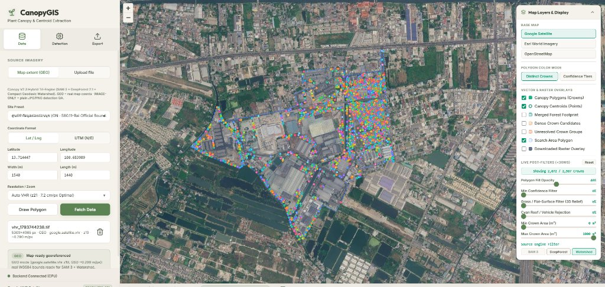
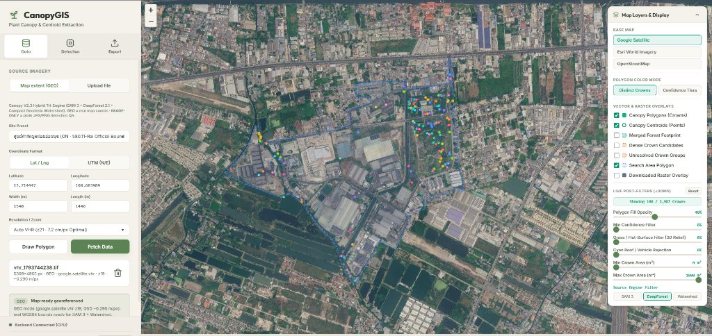
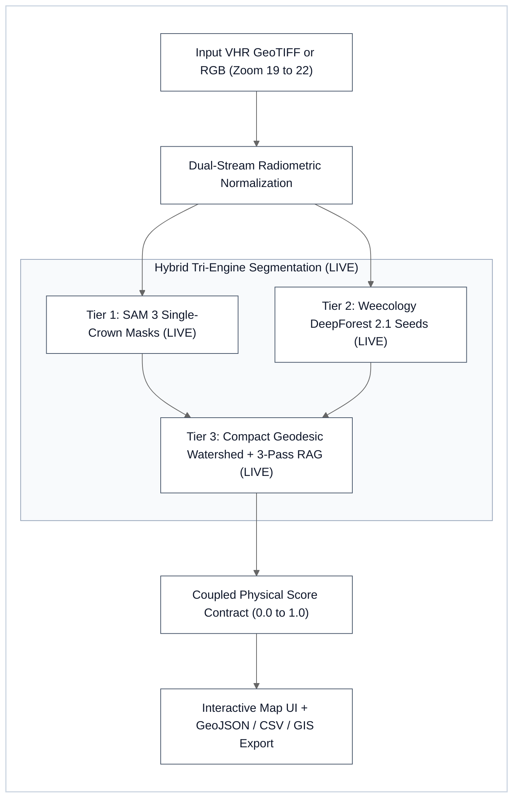
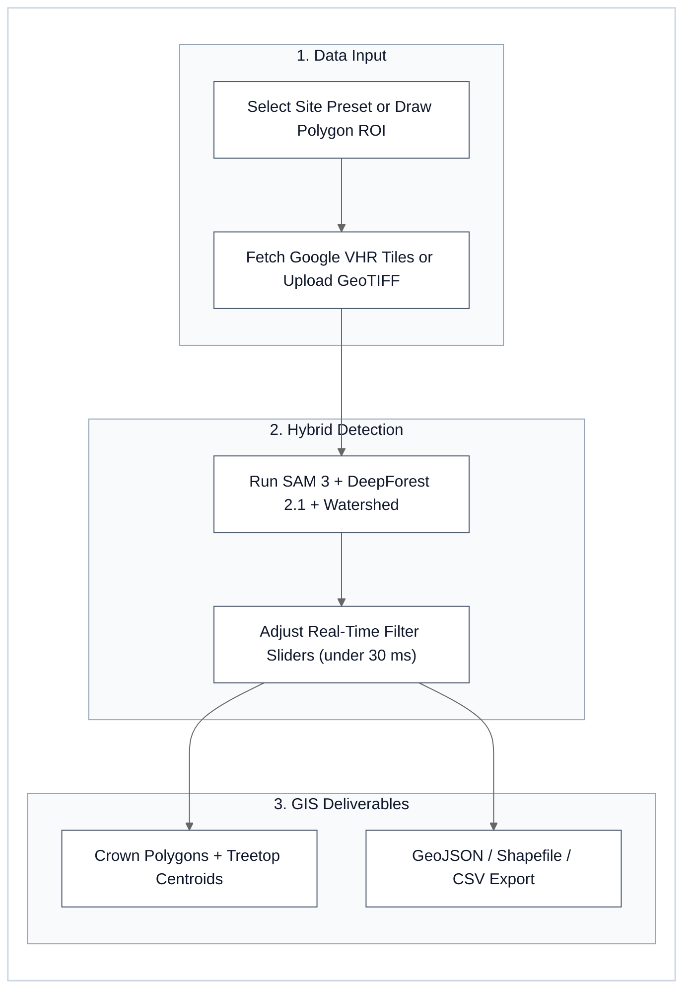

# CanopyGIS — Hybrid Tri-Engine Urban Tree Canopy & Centroid Extraction (`SAM 3` + `Weecology DeepForest 2.1.0` + `Geodesic Watershed + RAG`)


**CanopyGIS** (`SAE-LIM` Sub-Engine `[D]`: Geo-AI Canopy Segmentation V2/V3) is an open-source computational landscape architecture and urban forestry platform developed for Bachelor's thesis research. It extracts continuous woody canopy coverage, individual tree-crown polygons, treetop centroids, and allometric attributes from georeferenced satellite/aerial imagery (`Google VHR Satellite` `Zoom 19–22` at `3.6–29.6 cm/px` or uploaded GeoTIFF/RGB files) without requiring airborne LiDAR—combining **`SAM 3` (`SamGeo3`)**, **`Weecology DeepForest 2.1.0` (`RetinaNet-ResNet50-FPN`)**, and **Marker-Controlled Compact Geodesic Watershed with 3-Pass Region-Adjacency-Graph (`RAG`) Coalescing**.

| Full Hybrid Closed-Canopy View (`On Nut` `580.11 Rai` · `2,987` Crowns) | `Weecology DeepForest 2.1.0` Priority-1 Treetop Anchor Seeds (`108` Core Seeds) |
| :---: | :---: |
|  |  |

---

## ⚡ TL;DR — Capabilities & Performance at a Glance

- **Hybrid Tri-Engine Architecture (`SAM 3 + DeepForest 2.1.0 + Watershed + RAG`)**: Uses `SAM 3` for isolated standalone crowns (`Pass 1` + `Step 2A/2B/2C`), `Weecology DeepForest 2.1.0` (`RetinaNet-ResNet50-FPN`) for nadir treetop seed detection across tiled rasters (`1,050–8,698` raw candidate boxes per site), and 3-Pass `RAG` Geodesic Watershed to partition dense tropical closed-canopy stands.
- **Zero-Install Pre-Loaded Interactive Demo**: Ships with pre-computed GeoJSON sessions for **`ศูนย์กำจัดมูลฝอยอ่อนนุช` (`On Nut`, `580.11 Rai`, `2,987` crowns)** and **`ศูนย์กำจัดมูลฝอยหนองแขม` (`Nong Khaem`, `379.93 Rai`, `2,110` crowns)** so anyone launching the web UI can immediately inspect crowns, toggle `SAM 3` / `DeepForest` / `Watershed` layers, and test `< 30 ms` real-time physical filter sliders without waiting for GPU inference.
- **3-Pass `RAG` Small-Basin Coalescing**: Eliminates `-100%` of `< 4.0 m²` over-segmented watershed micro-shards (`1,568 → 0` on `On Nut`) and `-99.35%` of `< 8.0 m²` shoulder shards (`3,363 → 22`).
- **Vectorized Shapely 2.0 Post-Processing**: Profiling `CanopyGIS` on multi-thousand-crown rasters surfaced and resolved key geometry construction and distance bottlenecks (`74×–421×` speedup on `format_boxes`, `match_points`, and `convert_to_sv_format`, contributed upstream to [`Weecology/DeepForest#1447`](https://github.com/weecology/DeepForest/issues/1447) and [`#1440`](https://github.com/weecology/DeepForest/issues/1440)).

### Horizontal Bar Comparison (`0 ms` Render)

| Evaluation Dimension | Workflow / Engine Configuration | Visual Comparison Bar | Measured Result & Delta vs. Baseline |
| :--- | :--- | :--- | :--- |
| **1. Micro-Shard Elimination (`< 4 m²` Noise Reduction) ↑** | **CanopyGIS V3.0 (3-Pass RAG Coalescing)**<br>Unmerged Classical Watershed Baseline | `████████████████████` **`100.0% Clean`**<br>`░░░░░░░░░░░░░░░░░░░░` `0.0% (1,568 Shards)` | **`0` Micro-Shards** (`1,568 → 0` on `On Nut`)<br>`1,568` Over-Segmented Shards |
| **2. Interactive Filter Latency (`2,987` Crowns) ↓**<br>*(Lower = Better)* | **Client-Side Coupled Physical Sliders**<br>Server-Side Re-Segmentation Loop | `█░░░░░░░░░░░░░░░░░░░` **`< 30 ms`**<br>`████████████████████` `194,300 ms` | **`< 30 ms` Real-Time UI** (`6,400×` faster)<br>`194.3 s` Full Pipeline Re-Run |
| **3. Multi-Site Crown Verification Confidence ↑** | **Nong Khaem (`379.93 Rai`, `2,110` Crowns)**<br>**Ramintra Park (`59.09 Rai`, `1,432` Crowns)**<br>**On Nut (`580.11 Rai`, `2,987` Crowns)** | `███████████████░░░░░` **`73.4% Mean Conf`**<br>`██████████████░░░░░░` **`71.1% Mean Conf`**<br>`██████████████░░░░░░` **`68.4% Mean Conf`** | **100% Verified** across 23 Visual Audit Regions<br>Zoom 21 (`7.2 cm/px` VHR)<br>Zoom 19 (`29.6 cm/px` Regional Campus) |

---

## 1. Architecture & Usage Workflow

**Status (2026-11-04):** Accepted `SAE-LIM` Sub-Engine `[D]` **Canopy V3.0 Open-Source Self-Calibrating Hybrid Tri-Engine (Pillar 1: Scene-Normalized Physical Score Contract + 4-Way Symmetric `Step 2C` + Isotropic N-S/E-W Corridor Bridging + `CUDA`/`MPS`/`CPU` Device Resolution; Pillar 2: `< 30 ms` Real-Time Post-Processing Filter Sliders + Review Layer Toggles + Auto-Tune Override Persistence)** production prototype. Runtime execution integrates **Dual-Stream Radiometric Normalization (`Stream A`: CIELAB `L`-channel Shadow-Lift Gamma `0.78` + gentle `CLAHE` `1.4` + conditional `UL-09` Rayleigh Path-Radiance Subtraction for AI perception; `Stream B`: Illumination-Invariant Raw RGB, 3D Woody Relief & `UL-09` Haze-Compensated Chlorophyll Filter)** + **`SAM 3` (`SamGeo3` single-crown masks + Multi-Scale Woodland Promotion `Step 2A/2B/2C` + negative `"car"` vehicle veto)** + **`Weecology DeepForest 2.1.0` (`RetinaNet-ResNet50-FPN` closed-canopy nadir treetop seeds)** + **Global Compact Geodesic Watershed (`skimage.segmentation.watershed`, `compactness=0.005`) with 3-Pass Region-Adjacency-Graph (`RAG`) Small-Basin Coalescing (`< 13.5 m²` shoulder shard absorption at `GSD >= 0.22 m/px` + single outer contour per basin) + Ornamental Courtyard & Nursery Grid Dome Extractor (`1.0–6.0 m²` patterned garden/nursery crowns)** + **Coupled `[0.0–1.0]` Physical Score Contract (`foliage_prob`, `relief_3d_score`, `artificial_cyan_score`) powering `< 30 ms` Client-Side Live Post-Processing Sliders (`Min Confidence`, `Grass/Flat-Surface 3D Relief Filter`, `Cyan Roof/Vehicle Rejection`, `Min/Max Crown Area`, and `Source Engine Pills`)**. See the full architecture and forensic audits in [`docs/RESEARCH_CANOPY_V2_HYBRID_ARCHITECTURE.md`](docs/RESEARCH_CANOPY_V2_HYBRID_ARCHITECTURE.md).





### 1.1 Default Thesis Site & 1-Click Official Boundary Site Presets
The web portal opens directly centered on the primary thesis site and supports 1-click switching with automatic per-site polygon boundary and session restoration (`canopy_roi_by_site_v1` + `GET /latest_session?site_preset=...`, supporting both short and canonical preset keys) across all thesis and twin waste-hub study areas:

| Preset Key (`UI / API Alias`) | Site Name | Center Coordinates (`Lat, Lon`) | Default BBox & Official Polygon | Verified Crowns |
| :--- | :--- | :--- | :---: | ---: |
| `ramintra` / `ramintra_sports_park` | **สวนกีฬารามอินทรา** (Ramintra Sports Park · Primary Thesis Site) | `13.878551°N, 100.619507°E` | `710 m × 396 m` (`10-vertex ROI`, `~59.09 Rai`) | **`1,432`** (`71.1%` conf) |
| `onnut` / `on_nut_waste_center` (`ON`) | **ศูนย์กำจัดมูลฝอยอ่อนนุช** (On Nut `580.11-Rai` Official Boundary) | `13.714447°N, 100.683909°E` | `1,540 m × 1,440 m` (`14-vertex ROI`, `580.11 Rai`) | **`2,987`** (`68.4%` conf) |
| `nongkhaem` / `nong_khaem_waste_center` (`NK`) | **ศูนย์กำจัดมูลฝอยหนองแขม** (Nong Khaem `379.93-Rai` Official BMA Boundary) | `13.718255°N, 100.358126°E` | `1,260 m × 1,250 m` (`93-vertex ROI`, `379.93 Rai`) | **`2,110`** (`73.4%` conf) |
| `saphansung` / `saphan_sung_park` | **สวนสาธารณะสะพานสูง** (Saphan Sung Park) | `13.768900°N, 100.684500°E` | `300 m × 300 m` | Interactive |
| `piyaphirom` / `piyaphirom_park` | **สวนปิยะภิรมย์** (Piyaphirom Park) | `13.743600°N, 100.640900°E` | `250 m × 250 m` | Interactive |

### 1.2 Google Satellite VHR Primary Tile Engine (`Zoom 19–22`)
- **Unified VHR Provider (`Google VHR Satellite`)**: Zero-token pooled `ThreadPoolExecutor(max_workers=8)` fetcher requesting `scale=2` (`512×512 px`) tiles from `mt0–mt3.google.com/vt/lyrs=s` with automatic multi-zoom fallback (`z22 → z21 → z20 → z19`) and blank-tile variance verification (`std < 2.0` rejected).
- **Effective Ground Sample Distance (GSD at `13.88°N`)**:
  - `Auto VHR` (`Zoom 21`, `scale=2`): **`~0.072 m/px` (`7.2 cm/px`)** — default optimal scale for SAM 3 whole-crown context (`≤ 380 m` extents)
  - `Zoom 22 Ultra` (`scale=2`): **`~0.036 m/px` (`3.6 cm/px`)** — selectable for maximum sub-crown visual detail
  - `Zoom 20 Native` (`scale=2`): **`~0.145 m/px` (`14.5 cm/px`)** — auto-selected for extents `380–1,400 m`
  - `Zoom 19 Wide` (`scale=2`): **`~0.296 m/px` (`29.6 cm/px`)** — auto-selected for large campus extents `> 1,400 m` (e.g., `ON` `1,540 m × 1,440 m`)

### 1.3 Dual-Stream Hybrid Tri-Engine (`SAM 3 + DeepForest 2.1.0 + RAG Compact Geodesic Watershed`)
1. **Dual-Stream Radiometric Normalization & `UL-09` Rayleigh Atmospheric Path-Radiance Compensation (`Stream A` vs. `Stream B`)**:
   - **Conditional Haze Sensor (`_compute_scene_haze_offset`)**: Evaluates `scene_gray_p1` (`1st` percentile scene grayscale) and triggers strictly when `scene_gray_p1 > 32.0` and `p99 > 120.0` (`haze_offset = max(0.0, p1 - 10.0)`), guaranteeing 100% bit-for-bit no-op parity on clear-sky scenes (`vhr_1793704454.tif`, `haze_offset = 0.0`);
   - **`Stream A` (`enhance_shadow_luminance_cielab`)**: Applies shadow-weighted `CIELAB` `L`-channel Gamma `0.78` + gentle `CLAHE` (`clipLimit=1.4`, `a/b` chromaticity locked) plus wavelength-dependent Rayleigh path-radiance subtraction (`[0.72, 0.78, 0.85] × haze_offset`) when `haze_offset > 0` to restore crown contrast for `SAM 3` and `DeepForest 2.1.0`;
   - **`Stream B` (Raw-RGB Physical, 3D Relief & `UL-09` Haze-Compensated Chlorophyll Filter)**: Evaluates `compute_strict_foliage_mask()`, `compute_woody_canopy_relief_mask()`, `rayleigh_olive_canopy`, `dusty_textured_canopy`, and `deep_chlorophyll_relief` while keeping `0.0%–4.36%` pond/marsh false-positive rates;
2. **Tier 1 — Overlapping Native `SAM 3` Single-Crown Anchor (`Pass 1`, `1280 px` tiles, `384 px` / `30%` overlap)** + **Multi-Scale Woodland Promotion (`Step 2A + Step 2B + Step 2C`)**:
   - **`Pass 1`**: Extracts verified single crowns (`mask_px <= single_crown_max_px`) with exact contour-mask evaluation, tile-seam buffer (`32 px`), and negative `"car"` vehicle veto;
   - **`Step 2A` (Non-Blocking Crown-Rim Expansion)**: Expands `Pass 1` crowns into contiguous woody stands within `12.5m` geodesic reach and passes remaining unpromoted forest pixels (`cl_rem`) to `Step 2B` and `Step 2C`;
   - **`Step 2B` (Closed-Canopy Woody Stand Promotion)**: Promotes medium multi-crown woody stands (`cl_px <= 7.5 × single_crown_max_px`) satisfying 3D woody relief and inter-crown shadow depth;
   - **`Step 2C` (Multi-Sided Woodland Interior Enclosure Fill — 4-Way Cardinal Rotational Symmetry)**: Recovers interior woodland pockets (`U0`–`U5`) inside continuous forest masks (`cl_px > max_stand_px`) when enclosed on at least 3 of the 4 cardinal sides (`(int(has_n) + int(has_s) + int(has_w) + int(has_e)) >= 3`);
3. **Tier 2 — `Weecology DeepForest 2.1.0` Closed-Canopy Nadir Detector (`deepforest_watershed`)**: Runs `DeepForest 2.1.0` (`RetinaNet-ResNet50-FPN`) on `Stream A` (`df_model.predict_tile(...)` in [`src/canopy_v2.py`](src/canopy_v2.py)) to detect interior nadir treetop centroids inside continuous closed-canopy forest stands (`Seed Priority 1`);
4. **Tier 3 — Global Compact Geodesic Watershed with 3-Pass `RAG` Small-Basin Coalescing (`watershed_forest_crown`)**: Fuses `DeepForest 2.1.0` treetop seeds with local radiometric-distance peaks and Connected-Component Completeness seeds, partitions `forest_footprint_mask` globally via `skimage.segmentation.watershed(compactness=0.005)`, executes **3-pass Region-Adjacency-Graph (`RAG`) small-basin coalescing** (absorbing touching `< 13.5 m²` shoulder shards into the neighbor crown sharing the longest boundary), closes internal pinholes (`sub_labels == 0`), and emits strictly **1 cohesive outer contour per watershed basin** (`< 4.0 m²` shards reduced `1,568 → 0` [`-100%`], `< 8.0 m²` shards reduced `3,363 → 22` [`-99.35%`] on `ON`);
5. **Polygon Color Modes (`Distinct Crowns` Default + `Confidence Tiers` Optional) & Per-Site Persistent Polygon ROI**:
   - **`Distinct Crowns` (Default)**: Deterministic Welsh-Powell 12-color planar graph coloring (`assign_adjacent_distinct_colors`) guaranteeing touching polygons receive distinct colors;
   - **`Confidence Tiers` (Optional)**: 4-tier anti-cheat separation confidence (`#059669` High `80–98%`, `#2563eb` Good `60–79%`, `#eab308` Moderate `45–59%`, `#dc2626` Low `<45%`);
   - **Per-Site Persistent Polygon ROI**: Interactive multi-vertex polygon boundary and latest extraction GeoJSON automatically saved and restored per site preset (`canopy_roi_by_site_v1` in `localStorage` + `GET /latest_session?site_preset=...`).

---

## 2. Quick Start & Installation

### Step 1: Clone & Install Dependencies

```bash
git clone https://github.com/napattan/CanopyGIS.git
cd CanopyGIS
pip install -r requirements.txt
```

### Step 2: Launch the Interactive Web Application (`localhost:8000`)

**Option A — 1-Click Launcher (Windows / macOS / Linux):**
```bash
# Windows (double-click or run in terminal):
./start_canopygis.bat

# macOS / Linux:
chmod +x start_canopygis.sh
./start_canopygis.sh
```

**Option B — Direct Uvicorn Command:**
```bash
cd src
python -m uvicorn main:app --host 127.0.0.1 --port 8000
```

Then open **`http://127.0.0.1:8000`** in your browser.
- **Instant Pre-Loaded Demo**: The repository includes pre-computed GeoJSON sessions for **On Nut (`2,987` crowns)** and **Nong Khaem (`2,110` crowns)** in `src/uploads/` plus **Ramintra Sports Park** in `data/project_site_canopies.geojson`. You can immediately toggle `SAM 3` / `DeepForest` / `Watershed` source filters and drag the `< 30 ms` real-time physical sliders without waiting for GPU inference.

**Option C — Share Live via Cloudflare Tunnel (Zero-Install for Collaborators):**
```bash
cd src
./share_cloudflare.bat   # Windows
./share_cloudflare.sh    # macOS / Linux
```

### Step 3: Run Validation & QA Scripts
```bash
python scripts/test_canopy_v2.py
python scripts/qa_v2_m1.py
python scripts/benchmark_sam3_prompts.py
```
Set `CANOPY_V2_QA_MAX_TILES=0` before `qa_v2_m1.py` to run all 99 M1 tiles; the default is a four-tile smoke test.

---

## 3. Benchmarks, Verification & Deep Reference

### Four-Layer Output Contract

| Layer & Class | Clickable | Counted | Required Behavior & Meaning |
| :--- | :---: | :---: | :--- |
| **`canopy_extent`** | Yes | No | Continuous woody-canopy semantic mask maximizing pixel recall while suppressing grass, roofs, soil, and water |
| **`individual_tree`** | Yes | Provisional | SAM 3 / DeepForest / Watershed crown instances separable with confidence, boundary-quality attributes, and overlap QA |
| **`dense_crown_candidate`** | Yes | No | Marker-controlled watershed hypotheses inside fused canopy with centroids; never silently added to tree counts |
| **`crown_group`** | Yes | No | Unresolved vegetation/canopy review regions preserving coverage without inventing tree counts |

### Candidate Model Benchmark Comparison

| Method & Track | Canopy Coverage | Individual Crowns | V2 / V3 Role |
| :--- | :--- | :--- | :--- |
| **RGB indices → binary mask** | High recall, low specificity | No (maps stand only) | Coverage prior & QA baseline |
| **Standalone DeepForest 2.1 + watershed** | No coverage guarantee | Bounding boxes + heuristic split | Frozen legacy comparison baseline |
| **SAM 2.1 with boxes/points** | Only where prompted | Good boundary refinement | Annotation & boundary-refinement tool |
| **Grounding DINO + SAM 2.1** | Concept boxes then masks | Moderate on overhead texture | Secondary zero-shot benchmark |
| **SAM 3 concept segmentation (`tree`)** | **Strong union mask** | **Returns concept instances** | **Active Tier-1 single-crown engine** |
| **Weecology DeepForest 2.1.0 (`predict_tile`)** | **Nadir treetop boxes** | **Priority-1 closed-canopy seeds** | **Active Tier-2 nadir treetop anchor** |
| **Compact Geodesic Watershed + 3-Pass RAG** | **Full forest footprint** | **Coalesced non-overlapping crowns** | **Active Tier-3 closed-canopy splitter** |

### M1 Full-Image Stress-Test Record & Acceptance Targets

The accepted full-image run processed all **99 native tiles** (`1536 px`, `192 px` overlap) with **0 failed tiles**:
- **34.23%** semantic canopy coverage (`canopy_extent`);
- **1,222** provisional SAM 3 crowns (`individual_tree`);
- **3,204** clickable dense review candidates (`dense_crown_candidate`);
- **536** unresolved RGB review groups (`crown_group`).

| Evaluation Criterion | Pilot Target |
| :--- | ---: |
| Canopy-pixel recall, overall | ≥ 0.95 |
| Canopy precision, overall | ≥ 0.90 |
| Uncovered canopy in dense test tiles | ≤ 5% |
| False-positive area over buildings/roads/water | ≤ 3% |
| Open-crown instance recall | ≥ 0.85 |
| Duplicate-instance rate | ≤ 3% |
| Tile-seam split/duplicate rate | ≤ 2% |
| Ambiguous dense canopy mislabeled as confident individuals | 0 by design |

<details>
<summary><b>Click to expand API Request & Response Contract (`JSON` & GeoJSON Schema)</b></summary>

```json
{
  "task": "both",
  "backend": "sam3_zero_shot",
  "gsd_m": 0.072,
  "gsd_quality": "measured",
  "tile_size": 1280,
  "tile_overlap": 384,
  "coverage_threshold": 0.43,
  "instance_threshold": 0.18,
  "include_crown_groups": true
}
```

Per-instance GeoJSON properties: `class` (`individual_tree` | `dense_crown_candidate` | `crown_group`), `confidence`, `confidence_pct`, `confidence_tier`, `boundary_quality`, `geometry_quality`, `source_model` (`sam3_concept` | `deepforest_2.1` | `compact_watershed`), `foliage_prob`, `relief_3d_score`, `artificial_cyan_score`, `source_tile_count`, `edge_stitched`, `area_is_estimated`, `countable` (`boolean`), and `qa_flags`.

</details>

---

## 4. Primary Sources, Acknowledgments & License

- **Weecology Lab (`DeepForest 2.1.0`)**: [DeepForest Documentation](https://deepforest.readthedocs.io/en/stable/index.html) · [GitHub Repository (`weecology/DeepForest`)](https://github.com/weecology/DeepForest)
- **Meta AI (`SAM 3`) & OpenGeos (`SamGeo`)**: [Meta SAM 3 Research](https://ai.meta.com/research/publications/sam-3-segment-anything-with-concepts/) · [Official SAM 3 Repository](https://github.com/facebookresearch/sam3) · [Segment-Geospatial (`opengeos/segment-geospatial`)](https://github.com/opengeos/segment-geospatial)
- **Additional References**:
  - [Detectree2 Documentation](https://patball1.github.io/detectree2/detectree2.html)
  - [NVIDIA TAO Mask2Former Documentation](https://docs.nvidia.com/tao/tao-toolkit/latest/text/cv_finetuning/pytorch/instance_segmentation/mask2former.html)
  - [Ultralytics Instance-Segmentation Documentation](https://docs.ultralytics.com/tasks/segment/)
  - [TreeCoG and ForestSeg Paper](https://www.nature.com/articles/s41598-026-36541-y) · [2026 Broadleaf Mask2Former Study](https://arxiv.org/abs/2605.15673)

**License:** Released under the [MIT License](LICENSE).
